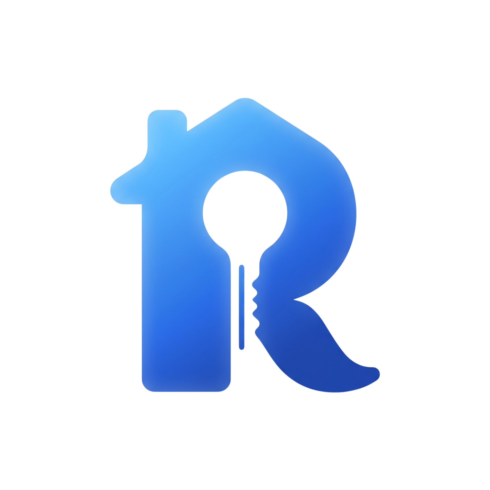

# PM Workspace — Doc Index (organized by phase)

PM owns this folder. Docs are grouped by phase (mirrors `PROJECT_PLAN.md`). Create the next phase folder when that phase starts. **Global source-of-truth docs (`requirement.md`, `PROJECT_PLAN.md`) live here at the `pm/` root**; phase folders hold phase-scoped docs.

| Phase | Folder | Focus | Docs |
|-------|--------|-------|------|
| 0 | `phase-0/` | Market & customer discovery (1-week sprint) | `market-analysis.md`, `product-sketch.md`, `issues/` (7 P0 issues), `discovery/` ([index](phase-0/discovery/README.md)) |
| 1 | `phase-1/` | Setup + requirements freeze (28/08–09/09) | `business-rules.md`, `issues/` (11 P1 issues), `discovery/` incl. `user_flow/` (per-role SoT cho navigation/UI) |
| 2 | `phase-2/` | Design (W5–6: screen list, wireframe, ERD, API, diagrams) | `issues/` (7 P2 issues), `discovery/` incl. `wire_frame/`, `diagrams/`, [`assets/`](phase-2/discovery/assets/) |
| 3 | `phase-3/` | Scaffolding + first vertical slice (W7–8) | `issues/` ([P3-01](phase-3/issues/P3-01-mobile-apidog-e2e-research.md) Apidog mock research · [P3-02](phase-3/issues/P3-02-microservices-architecture-research.md) SOA architecture · [P3-03](phase-3/issues/P3-03-database-per-service-design.md) database-per-service · [P3-04](phase-3/issues/P3-04-free-tier-db-storage-poc.md) free-tier DB/storage) |
| 4 | `phase-4/` | Identity, FE foundation, infra (closed 21/10) | [README](phase-4/README.md), `issues/` |
| 5 | `phase-5/` | FE Auth foundation + Tenancy Building/Room (It4) | [README](phase-5/README.md), [`issues/`](phase-5/issues/README.md) |
| 6 | `phase-6/` | MVP core: Contract, Billing, Payment, landlord Web screens, demo (It5–It7) | [README](phase-6/README.md), [`issues/`](phase-6/issues/README.md) (template: [`_TEMPLATE.md`](phase-6/issues/_TEMPLATE.md)) |

**Source of truth (SoT):** `requirement.md` (scope) and `PROJECT_PLAN.md` (schedule), both at the `pm/` root. Never change scope without PM approval; record changes in Notion decision log.

**Task tracking:** until Linear or GitHub Projects is chosen (target Phase 1), tasks are tracked as markdown issues in `phase-0/issues/` (P0-01…P0-07). Migrate them 1:1 when the tracker is decided.

Teacher-facing reports may be written in Vietnamese; everything else in English.

## Phase 2 discovery assets

| Asset | Preview |
|-------|---------|
| [Home header](phase-2/discovery/assets/header-home.svg) |  |
| [Login header](phase-2/discovery/assets/header-login.svg) |  |
| [Landlord logo](phase-2/discovery/assets/landlord-logo.png) |  |
| [Tenant logo](phase-2/discovery/assets/tenant-logo.png) |  |
