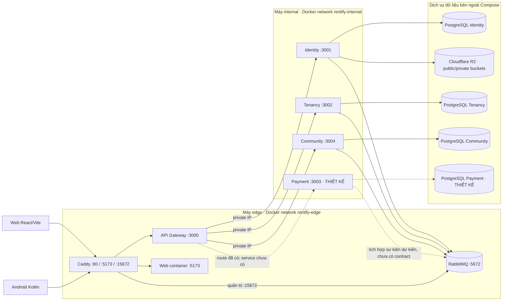
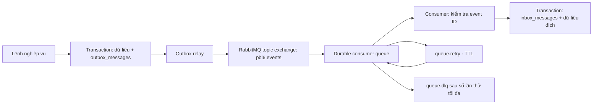

# P8-10a — Kiến trúc vi dịch vụ và hạ tầng triển khai

**Bản bàn giao cho báo cáo cuối kỳ · 16/11/2026.** Các mục dưới đây tương ứng với 1.2, 4.1–4.5, 5.2 và 5.7 của khung báo cáo. Sơ đồ Mermaid có thể chèn trực tiếp vào Markdown hoặc xuất SVG/PNG khi ráp bản Word.

**Quy ước trạng thái:** đường liền và nhãn **có mã nguồn/cấu hình** biểu thị thành phần tìm thấy trong workspace; đường nét đứt và nhãn **thiết kế** biểu thị thành phần chưa có mã nguồn hoặc chưa được bật trong cấu hình triển khai. Có cấu hình trong repo không đồng nghĩa đã xác nhận dịch vụ đang chạy trên máy chủ.

**Tệp sơ đồ độc lập:** [kiến trúc hệ thống](diagrams/P8-10a-system.mmd) và [luồng sự kiện](diagrams/P8-10a-event-flow.mmd).

## 1.2. Sơ đồ thiết kế kiến trúc hệ thống



Hai host dùng hai Docker bridge network **khác nhau**. HTTP giữa host đi qua private IP của EC2; RabbitMQ trên edge cũng nhận kết nối từ internal host qua private IP. Database và R2 không nằm trong hai Compose. Mỗi service dùng thông tin kết nối dữ liệu riêng; repo chỉ có template URL, chưa đủ bằng chứng để khẳng định mỗi service đã có một Supabase project/instance riêng. [Compose edge](../../infra/docker-compose.edge.yml), [Compose internal](../../infra/docker-compose.internal.yml), [Gateway route](../../api-gateway/src/constants/route-paths.constants.ts).

### 1.2.1. API Gateway

Client gọi API qua Caddy rồi đến Gateway. Gateway định tuyến `/api/v1/auth`, `/users`, `/media` sang Identity; `/buildings`, `/rooms`, `/contracts`, `/invoices` sang Tenancy; `/conversations`, `/messages`, `/notifications`, `/issues` sang Community. Gateway đã khai báo `/payments`, `/me/payments` và `PAYMENT_SERVICE_URL` cho Payment, nhưng chưa có service đích trong workspace. Các endpoint `internal/*` không được Gateway công khai. Gateway kiểm tra JWT/JWKS và giới hạn tần suất; service tiếp tục kiểm tra quyền của chính mình. [Route map](../../api-gateway/src/constants/route-paths.constants.ts), [env mẫu](../../infra/env/api-gateway.env.example).

### 1.2.2. Kiến trúc hướng sự kiện



Identity, Tenancy và Community có mã nguồn Outbox/Inbox. Producer ghi event trong cùng transaction với dữ liệu nghiệp vụ; relay phát sự kiện với persistent message và publisher confirm. Consumer ghi event ID vào inbox để tránh xử lý trùng, rồi cập nhật dữ liệu trong transaction cục bộ. Cơ chế là **at least once**, không phải giao dịch phân tán. Queue bền vững, có retry và DLQ. Payment chưa có mã nguồn nên không được gán publisher, consumer, exchange riêng hay routing key giả định. [Cấu hình RabbitMQ](../../community-service/src/shared/infrastructure/messaging/rabbitmq/rabbitmq-config.service.ts), [outbox relay](../../Tenancy-Service/src/modules/outbox/application/outbox-relay/outbox-relay.handler.ts), [quyết định P9-D83](../phase-9/decisions.md).

### 1.2.3. Cơ sở dữ liệu theo service

Identity, Tenancy và Community dùng PostgreSQL qua `DATABASE_URL` riêng trong file env của từng container. Tenancy/Community có thêm `MIGRATION_DATABASE_URL` để chạy migration qua kết nối trực tiếp. Không có PostgreSQL container trong Compose. Payment cần database riêng khi triển khai, nhưng hiện chưa có schema, URL hay migration để xác nhận. Không gọi đây là một cụm PostgreSQL vật lý hoặc tuyên bố đã phân quyền người dùng DB vì repo không lưu cấu hình Supabase thực tế. [Env Identity](../../infra/env/identity.env.example), [Tenancy](../../infra/env/tenancy.env.example), [Community](../../infra/env/community.env.example).

### 1.2.4. Ứng dụng khách

Web dùng React/Vite, được phục vụ bởi container `web` qua Caddy `:5173`; API base URL lấy từ `VITE_API_BASE_URL`. Android là ứng dụng Kotlin, gồm module tenant và landlord. Cả hai là client của Gateway; ứng dụng Android không nằm trong Compose. Các ảnh/tài liệu tải lên R2 bằng URL cấp bởi Identity theo luồng Media, không lưu nhị phân trong PostgreSQL. [Web env](../../fe/.env.example), [Android modules](../../mobile/settings.gradle.kts), [Media storage](../../Identity-Service/src/modules/media/infrastructure/storage/r2-object-storage.ts).

## 4.1. Hạ tầng máy chủ và phần cứng

| Thành phần | Cấu hình có bằng chứng trong repo | Giới hạn của bằng chứng |
|---|---|---|
| Edge EC2 | Tài liệu infra mô tả Ubuntu, máy 1 GB RAM loại ví dụ `t3.micro`; chạy Caddy, Web, Gateway, RabbitMQ. | Chưa có kết quả `aws ec2 describe-instances`, `lscpu`, `free -h` của máy đang chạy. |
| Internal EC2 | Tài liệu infra mô tả Ubuntu, máy 1 GB RAM; chạy Identity, Tenancy và Community khi bật. | Payment chưa được bật; không có số CPU/RAM sử dụng theo container. |
| Swap | `setup-swap.sh` tạo file swap 2 GB, `vm.swappiness=10`. | Swap là cấu hình script, không xác nhận đã chạy trên cả hai host. |
| Giới hạn tài nguyên | Compose hiện không đặt `cpus`, `mem_limit` hay `deploy.resources` cho từng service. | Không thể lập bảng phân bổ CPU/RAM định lượng từ mã nguồn; cần chụp `docker stats` trên môi trường báo cáo. |

Image được GitHub Actions build và đẩy lên Docker Hub; `deploy.sh` kéo image về EC2. Không có bước build trên host trong Compose. [Infra README](../../infra/README.md), [setup swap](../../infra/scripts/setup-swap.sh), [deploy](../../infra/scripts/deploy.sh).

## 4.2. Mạng, API Gateway và Caddy

| Lớp | Cổng / đường đi | Cấu hình hiện có |
|---|---|---|
| Internet → Caddy | `80` API, `5173` Web | Caddy proxy lần lượt tới `api-gateway:3000` và `web:5173`. |
| Quản trị RabbitMQ | `15672` → `rabbitmq:15672` | Caddy có listener; Security Group phải chỉ cho IP quản trị. |
| Edge → internal | `3001`, `3002`, `3004`; `3003` khi có Payment | Backend publish port ra host; Security Group chỉ cho phép nguồn nội bộ. |
| Internal → edge | `5672` | AMQP tới RabbitMQ qua private IP; không mở Internet. |
| Database/R2 | Kết nối đi ra ngoài từ service | Không có container/port inbound database hay R2 trong Compose. |

`Caddyfile` hiện dùng site address `:80`, `:5173`, `:15672`, không có domain, HTTPS listener `:443` hoặc TLS directive. Vì vậy **chưa có cấp chứng chỉ SSL tự động ở cấu hình hiện tại**; chỉ mô tả đây là khả năng khi bổ sung domain và cấu hình HTTPS sau này. Caddy bật nén `zstd/gzip` và một số security headers. [Caddyfile](../../infra/caddy/Caddyfile), [hướng dẫn Security Group](../../infra/INSTRUCTION.md).

## 4.3. PostgreSQL theo từng dịch vụ

| Chủ sở hữu | Runtime connection | Migration connection | Trạng thái |
|---|---|---|---|
| Identity | `env/identity.env` → `DATABASE_URL` | `.env.example` của Identity có `MIGRATION_DATABASE_URL`; template infra hiện không liệt kê. | Có mã nguồn và template runtime. |
| Tenancy | `env/tenancy.env` → `DATABASE_URL` | `MIGRATION_DATABASE_URL` | Có mã nguồn và template. |
| Community | `env/community.env` → `DATABASE_URL` | `MIGRATION_DATABASE_URL` | Có mã nguồn và template; container đã khai báo trong Compose. |
| Payment | Chưa có | Chưa có | Thiết kế: cần database/role riêng, migration và secret riêng khi service được phát triển. |

Template Supabase dùng pooler `6543` cho runtime và cổng `5432` cho migration ở Tenancy/Community; `DB_SSL=true`. Từng service chỉ truy cập database của mình theo URL được cấp. Chính sách role/GRANT và backup của Supabase cần xác minh từ dashboard quản trị trước khi đưa số liệu cụ thể vào báo cáo. Không đưa connection string thật vào tài liệu. [Template DB](../../infra/env/tenancy.env.example), [Community](../../infra/env/community.env.example).

## 4.4. RabbitMQ

RabbitMQ chạy image `rabbitmq:3-management-alpine` trên edge, lưu dữ liệu trong volume `rabbitmq_data`. Các service dùng topic exchange `pbl6.events` trong template triển khai. Consumer khai báo queue durable, retry queue `<queue>.retry` với TTL, DLQ `<queue>.dlq`, `x-single-active-consumer` và persistent publish. Mặc định template dùng `RABBITMQ_CONSUMER_MAX_ATTEMPTS=5`, delay `10000 ms`; giá trị thật trên server cần đối chiếu env. [Compose edge](../../infra/docker-compose.edge.yml), [RabbitMQ config](../../community-service/src/shared/infrastructure/messaging/rabbitmq/rabbitmq-config.service.ts).

| Consumer/queue có trong mã nguồn | Routing key bind |
|---|---|
| `tenancy.identity-lifecycle` | `user.registered`, `user.email_verified`, `user.updated`, `user.locked`, `user.unlocked`, `user.deleted` |
| `community.building-context` | `building.created` |
| `community.contract-context` | `contract.activated`, `contract_member.added`, `contract_member.linked`, `contract_member.left` |
| `community.contract-member-added` | `contract_member.added` |
| `community.notification` | `notification.requested` |
| `community.email` | `email.send_requested` |
| `community.match-request-notification` | `match_request.created`, `.accepted`, `.rejected`, `.withdrawn` |
| `identity.media.owner-cleanup` | `building.deleted`, `room.deleted`, `user.deleted` |
| Payment | Chưa có queue/routing key; không khai báo trong sơ đồ sự kiện hiện hành. |

Các queue trên được xác minh từ hằng số/subscriber trong checkout ngày 16/11/2026; không khẳng định tất cả đã được deploy. [Tenancy lifecycle](../../Tenancy-Service/src/modules/contract/presentation/messaging/identity-lifecycle-consumer.constants.ts), [Community context](../../community-service/src/modules/conversation/presentation/messaging/contract-context-consumer.constants.ts), [Community notification](../../community-service/src/modules/notification/presentation/messaging/notification-consumer.constants.ts), [Media cleanup](../../Identity-Service/src/modules/media/presentation/messaging/media-owner-cleanup.constants.ts).

## 4.5. Lưu trữ tệp tin và đa phương tiện

Identity quản lý metadata Media trong PostgreSQL và object trên **Cloudflare R2** qua S3-compatible API. Bucket public dành cho avatar, cover/gallery; bucket private dành cho `contract_signed`, `meter_reading_evidence`, `ownership_proof`, CCCD và ảnh sự cố. Upload dùng presigned PUT URL; file private được truy cập sau kiểm tra quyền và URL tải có thời hạn. `MEDIA_UPLOAD_TTL_SECONDS=900`, `MEDIA_DOWNLOAD_URL_TTL_SECONDS=300`, `MEDIA_MAX_SIZE_BYTES=10485760` là giá trị trong `.env.example` của Identity, chưa xác nhận trên server. Khi thiếu `R2_*`, service vẫn khởi động nhưng Media API trả lỗi cấu hình. [Policy theo mục đích](../../Identity-Service/src/modules/media/domain/policies/media-purpose.policies.ts), [R2 adapter](../../Identity-Service/src/modules/media/infrastructure/storage/r2-object-storage.ts), [env Media](../../Identity-Service/.env.example).

## 5.2. Cấu hình biến môi trường

Chỉ ghi **tên biến và giá trị mẫu không nhạy cảm**. File thật (`.deploy.env`, `env/*.env`) ở từng host; không đưa password, khóa JWT, R2 hay SMTP vào báo cáo.

| Nhóm | Biến cấu hình và nguồn |
|---|---|
| Chọn stack/image | `DEPLOY_STACK`, `DOCKERHUB_USERNAME`, `IMAGE_TAG`, `IDENTITY_IMAGE`, `TENANCY_IMAGE`, `COMMUNITY_IMAGE`, `PAYMENT_IMAGE`, `COMPOSE_PROFILES` — [.deploy.env.example](../../infra/.deploy.env.example), [Compose internal](../../infra/docker-compose.internal.yml). `PAYMENT_IMAGE` chỉ có trong block comment. |
| Gateway | `PORT`, `NODE_ENV`, `IDENTITY_SERVICE_URL`, `TENANCY_SERVICE_URL`, `COMMUNITY_SERVICE_URL`, `PAYMENT_SERVICE_URL`, `PROXY_TIMEOUT_MS`, `JWKS_URL`, `JWT_ISSUER`, `JWT_AUDIENCE`, `RATE_LIMIT_WINDOW_MS`, `RATE_LIMIT_MAX`, `AUTH_RATE_LIMIT_MAX`, `REFRESH_RATE_LIMIT_MAX`, `CORS_ORIGINS` — [template](../../infra/env/api-gateway.env.example). Payment URL là route dự kiến. |
| RabbitMQ edge | `RABBITMQ_DEFAULT_USER`, `RABBITMQ_DEFAULT_PASS`; `env/rabbitmq-users.env` chứa `<service-user>=<password>` — [template users](../../infra/env/rabbitmq-users.env.example). |
| Identity | `APP_NAME`, `PORT`, `NODE_ENV`, `LOG_LEVEL`, `DATABASE_URL`, `DB_SSL`, `RABBITMQ_URL`, `RABBITMQ_EXCHANGE`, `RABBITMQ_EXCHANGE_TYPE`, `RABBITMQ_PUBLISH_MANDATORY`, `JWT_PRIVATE_KEY`, `JWT_PUBLIC_KEY`, `JWT_KEY_ID`, `JWT_ISSUER`, `JWT_AUDIENCE`, `SERVICE_TOKEN`, `TENANCY_SERVICE_URL`, `COMMUNITY_SERVICE_URL`, `INTERNAL_HTTP_TIMEOUT_MS`, `PUBLIC_APP_URL`, `OUTBOX_RETENTION_MS` — [infra template](../../infra/env/identity.env.example). Thêm `R2_ACCOUNT_ID`, `R2_ACCESS_KEY_ID`, `R2_SECRET_ACCESS_KEY`, `R2_PUBLIC_BUCKET`, `R2_PUBLIC_BASE_URL`, `R2_PRIVATE_BUCKET`, `MEDIA_UPLOAD_TTL_SECONDS`, `MEDIA_DOWNLOAD_URL_TTL_SECONDS`, `MEDIA_MAX_SIZE_BYTES` từ [service template](../../Identity-Service/.env.example); template infra hiện chưa chứa các biến Media này. |
| Tenancy | `APP_NAME`, `PORT`, `NODE_ENV`, `LOG_LEVEL`, `JWKS_URL`, `JWT_ISSUER`, `JWT_AUDIENCE`, `SERVICE_TOKEN`, `IDENTITY_SERVICE_URL`, `INTERNAL_HTTP_TIMEOUT_MS`, `DATABASE_URL`, `MIGRATION_DATABASE_URL`, `DB_SSL`, `RABBITMQ_URL`, `RABBITMQ_EXCHANGE`, `RABBITMQ_EXCHANGE_TYPE`, `RABBITMQ_PREFETCH`, `RABBITMQ_CONNECT_TIMEOUT_MS`, `RABBITMQ_PUBLISH_MANDATORY`, `RABBITMQ_CONSUMER_MAX_ATTEMPTS`, `RABBITMQ_CONSUMER_RETRY_DELAY_MS` — [infra template](../../infra/env/tenancy.env.example). `TRACKASIA_API_KEY`, `TRACKASIA_BASE_URL`, `TRACKASIA_TIMEOUT_MS` và các `OUTBOX_*` có trong [service template](../../Tenancy-Service/.env.example); template infra chưa liệt kê. |
| Community | `APP_NAME`, `PORT`, `NODE_ENV`, `LOG_LEVEL`, `JWKS_URL`, `JWT_ISSUER`, `JWT_AUDIENCE`, `SERVICE_TOKEN`, `IDENTITY_SERVICE_URL`, `TENANCY_SERVICE_URL`, `INTERNAL_HTTP_TIMEOUT_MS`, `DATABASE_URL`, `MIGRATION_DATABASE_URL`, `DB_SSL`, `RABBITMQ_URL`, `RABBITMQ_EXCHANGE`, `RABBITMQ_EXCHANGE_TYPE`, `RABBITMQ_PREFETCH`, `RABBITMQ_CONNECT_TIMEOUT_MS`, `RABBITMQ_PUBLISH_MANDATORY`, `RABBITMQ_CONSUMER_MAX_ATTEMPTS`, `RABBITMQ_CONSUMER_RETRY_DELAY_MS`, `OUTBOX_*`, `MAIL_HOST`, `MAIL_PORT`, `MAIL_SECURE`, `MAIL_USER`, `MAIL_PASS`, `MAIL_FROM`, `MAIL_FROM_NAME`, `EMAIL_DELIVERY_RETENTION_MS` — [infra template](../../infra/env/community.env.example). `FCM_*` có trong [service template](../../community-service/.env.example), không thuộc mục 4.6 của gói này. |
| Web | `VITE_API_BASE_URL` (và `VITE_SOCKET_DEBUG` trong template phát triển) — [FE template](../../fe/.env.example). Compose web pull image dựng sẵn; biến build của FE phải được thiết lập lúc tạo image, `env/web.env` không được Compose nạp. |
| Android | Không có file env theo mẫu Docker Compose; cấu hình build/app do dự án Android quản lý. [Android](../../mobile/README.md). |
| Payment | Chưa có `.env.example` hay mã nguồn để lập danh sách biến service. Chỉ có `PAYMENT_SERVICE_URL` tại Gateway và `PAYMENT_IMAGE` trong block comment của Compose. Các biến DB/broker/secret cho Payment phải được thiết kế và kiểm chứng khi triển khai. |

Các biến `OUTBOX_*` và cấu hình RabbitMQ còn có giá trị mặc định trong code; bảng này liệt kê các biến cần tra cứu khi cấu hình triển khai, không thay thế `.env.example` của từng repo. Cần đổi `RABBITMQ_URL` trong template infra Identity từ `rabbitmq:5672` sang **private IP edge** trước khi deploy vì hai host không chia sẻ Docker network.

## 5.7. Đóng gói và triển khai với Docker Compose

**Hai file Compose là cấu hình triển khai chính**: [edge](../../infra/docker-compose.edge.yml) chạy Caddy, Web, Gateway, RabbitMQ; [internal](../../infra/docker-compose.internal.yml) chạy Identity, Tenancy, Community. Payment hiện là block comment, nên lệnh Compose **không thể khởi chạy Payment**. Community có khai báo container nhưng README infra gọi là optional; thực tế file Compose hiện **không có `profiles`** cho Community, do đó `docker compose up` sẽ khởi chạy Community và cần `env/community.env`. Cần thống nhất lại hướng dẫn vận hành trước khi dùng ở môi trường sạch.

Các bước dựa trên script hiện có (thực hiện trên **mỗi** host; điền secret và host thật vào file env, không commit):

```bash
# Cả hai host Ubuntu
git clone <INFRA_REPOSITORY_URL> infra
cd infra
sudo ./scripts/setup-swap.sh
./scripts/setup-server.sh
cp .deploy.env.example .deploy.env

# Edge: đặt DEPLOY_STACK=edge trong .deploy.env
cp env/rabbitmq.env.example env/rabbitmq.env
cp env/rabbitmq-users.env.example env/rabbitmq-users.env
cp env/api-gateway.env.example env/api-gateway.env
DEPLOY_STACK=edge ./scripts/deploy.sh

# Internal: đặt DEPLOY_STACK=internal trong .deploy.env
cp env/identity.env.example env/identity.env
cp env/tenancy.env.example env/tenancy.env
cp env/community.env.example env/community.env
./scripts/generate-jwt-keys.sh
DEPLOY_STACK=internal ./scripts/deploy.sh
```

Trước khi chạy internal stack cần cấu hình `DATABASE_URL`, `MIGRATION_DATABASE_URL` nếu migration dùng, JWT, `SERVICE_TOKEN`, `RABBITMQ_URL` tới private IP edge, và các URL peer. Trước khi dùng Media cần thêm `R2_*` vào `env/identity.env`; trước khi dùng Community email cần SMTP hợp lệ. Image được CI/CD build và push, script `deploy.sh` dùng `docker compose pull` rồi `up -d --remove-orphans`, không tự biên dịch image. Lệnh kiểm tra sau khi deploy:

```bash
docker compose -f docker-compose.edge.yml ps       # trên edge
docker compose -f docker-compose.internal.yml ps   # trên internal
docker stats
```

**Trạng thái kiểm chứng:** đã đối chiếu tĩnh Compose, Caddyfile, script và env mẫu trong workspace. Máy làm việc này không có Docker Compose plugin (`docker compose version` báo `unknown command`), và không có thông số/credential máy EC2 để thử từ môi trường sạch. Vì vậy chưa có bằng chứng `up -d` thành công, CPU/RAM thực tế, TLS, Supabase role hay Payment runtime. Các mục này cần được Lead Author/owner hạ tầng bổ sung bằng log và ảnh chụp môi trường thử nghiệm trước khi ghi như kết quả đo trong báo cáo.

## Ghi chú bàn giao

- Bản sơ đồ Payment là **thiết kế bổ sung theo yêu cầu ngày 16/11/2026**. Không suy diễn API nghiệp vụ, bảng dữ liệu, event contract, payment provider hay trạng thái triển khai.
- Nội dung kiến trúc Payment hiện khác với quyết định Phase 8/9 vốn xếp Payment vào Stretch. Khi ráp báo cáo, ghi đúng mốc thời gian và trạng thái; không mô tả Payment như chức năng đã hoàn thành. [Phase 8](../phase-8/README.md), [P9-D83](../phase-9/decisions.md).
- Các đường dẫn nguồn trong file này trỏ tới checkout hiện tại để người biên soạn rà soát trước khi chốt bản DOCX/PDF.
