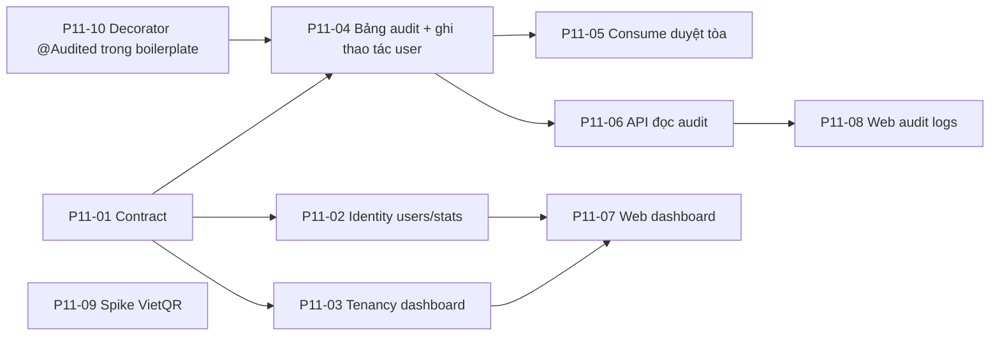

# Phase 11 — Admin dashboard, audit log, màn Web còn thiếu và nghiên cứu VietQR

Mục tiêu: hoàn thiện khu vực quản trị trên Web (dashboard hệ thống + nhật ký thao tác admin) theo [P11-D92](decisions.md#d92--admin-dashboard-và-audit-log), và nghiên cứu các dịch vụ VietQR có sandbox theo [P11-D93](decisions.md#d93--vietqr-chỉ-làm-spike-sandbox). Phase này **không gồm mobile**.

Audit log dùng decorator generic `@Audited` đặt trong `boilerplate/src/shared` (P11-10), để sau này mở rộng sang hành động hoặc service khác.

Kế thừa từ Phase 10: P10-10 (blocker đã chốt), P10-19/20/21/22 (chuyển thành P11-01 → P11-08), P10-30 (chuyển thành spike P11-09). Các task còn lại của Phase 10 vẫn theo dõi ở [tracker Phase 10](../phase-10/issues/README.md).

## Thứ tự làm

- P11-01 làm trước để BE và FE dựa vào cùng một contract.
- P11-10 (decorator generic trong boilerplate) làm song song với P11-01, là điều kiện của P11-04.
- P11-02, P11-03 làm song song; P11-04 bắt đầu khi P11-01 và P11-10 xong.
- FE có thể dựng giao diện bằng mock Apidog ngay sau P11-01, chỉ nối API thật khi BE merge.
- P11-09 độc lập, không chặn task nào.
- P11-11 → P11-14 (màn Web còn thiếu) có API sẵn, làm được ngay, không phụ thuộc các task admin. Thứ tự ưu tiên đề xuất: P11-13 (hợp đồng đang kẹt ở `suspended` nếu không có màn này) → P11-11 → P11-12 → P11-14.

## Quy ước

- Mỗi PR tối đa 3 points và khoảng 15 file. PR vào `main`, ít nhất 1 reviewer.
- Thay đổi API phải sửa `api-docs/src/` và chạy `npm run bundle`.
- FE không viết file test; kiểm chứng bằng `npm run build`, `npm run lint`, `npm run i18n:check`.
- Owner trong tracker là **đề xuất**, PM xác nhận khi giao.

Xem [tracker](issues/README.md) và [quyết định](decisions.md).
