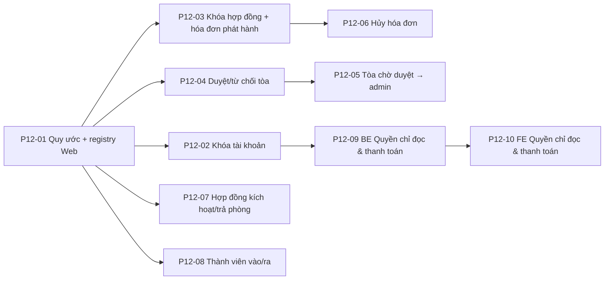

# Phase 12 — Thông báo nghiệp vụ end-to-end

Mục tiêu: mọi sự kiện nghiệp vụ quan trọng (duyệt tòa, hợp đồng, thành viên vào/ra, hóa đơn, khóa tài khoản) đều tạo thông báo **đọc được** cho đúng người, lưu vào lịch sử và mở đúng trang trên Web. Quy ước chung ở [P12-D95](decisions.md#d95--quy-ước-payload-thông-báo-nghiệp-vụ) và tài liệu kỹ thuật [`community-service/docs/notifications.md`](https://github.com/pbl6-home-renter/community-service/blob/main/docs/notifications.md).

**Nghiên cứu bổ sung ngày 2026-11-25:** [P12-09](issues/P12-09-performance-testing-research.md) đề xuất phương án kiểm thử hiệu năng cho Rentify. Task này độc lập với chuỗi task thông báo và chưa bao gồm cam kết triển khai hoặc chạy benchmark. Xem [P12-D99](decisions.md#d99--nghiên-cứu-kiểm-thử-hiệu-năng-trong-phase-12).

Mỗi task do **một BE member làm end-to-end** (service nguồn → community → fe) theo [P12-D98](decisions.md#d98--cách-giao-task). Phase này **không gồm mobile** (mobile chưa dịch theo `messageKey`).

## Hiện trạng khi bắt đầu phase

- Đã chạy đủ: sự cố (`issue.*`), ghép bạn (`match_request.*`), chat (chỉ push).
- Có gửi nhưng thiếu `messageKey` nên Web hiện **mã** (vd `USER_ACCOUNT_LOCKED_TITLE`): khóa/mở tài khoản, luồng khóa landlord trên hợp đồng.
- Chưa có thông báo: duyệt/từ chối tòa, tòa chờ duyệt, hủy hóa đơn, hợp đồng kích hoạt/trả phòng, thành viên vào/ra.
- Lịch sử thông báo đã được lưu vĩnh viễn trong bảng `notifications` của community-service.

## Thứ tự làm

- P12-02 và P12-03 ưu tiên trước vì đang hiển thị lỗi cho người dùng.
- P12-09 và P12-10 bổ sung xử lý quyền chỉ đọc và thanh toán hóa đơn cho tài khoản bị khóa theo P12-D100.
- [P12-11](issues/P12-11-locked-account-behavior-spec.md) đặc tả hành vi thực tế khi tenant/landlord bị khóa và liệt kê các điểm PM cần chốt; P12-09, P12-10, P11-13 tham chiếu issue này.
- P12-04, P12-07, P12-08 làm song song sau P12-01.
- P12-05 làm cuối vì cần API nội bộ mới bên Identity và đang có blocker.

## Quy ước

- Mỗi PR tối đa 3 points và khoảng 15 file. PR vào `main`, ít nhất 1 reviewer.
- Thay đổi API phải sửa `api-docs/src/` và chạy `npm run bundle`.
- FE không viết file test; kiểm chứng bằng `npm run build`, `npm run lint`, `npm run i18n:check`.
- Owner trong tracker là **đề xuất**, PM xác nhận khi giao.

Xem [tracker](issues/README.md) và [quyết định](decisions.md).
