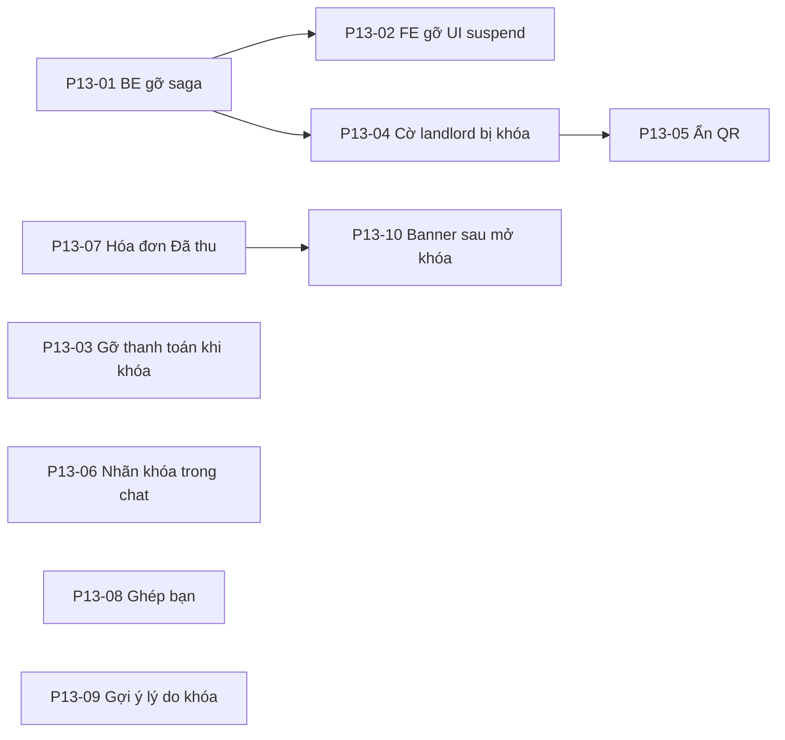

# Phase 13 — Chuẩn hóa nghiệp vụ khóa tài khoản

Mục tiêu: khóa tài khoản chỉ chặn **người vi phạm**, không làm hại người thứ ba đang thuê hợp pháp. App không tự đoán điều gì đã xảy ra ngoài đời; sau khi mở khóa, landlord tự cập nhật bằng các thao tác sẵn có.

Nguồn: tài liệu "Nghiệp vụ khóa tài khoản" (Thu Phương, 25/11/2026), đã review và cắt theo phạm vi ở [decisions.md](decisions.md) (P13-D101 → P13-D107). Hành vi code trước phase này: [P12-11](../phase-12/issues/P12-11-locked-account-behavior-spec.md).

## Thay đổi chính so với hiện tại

| Hạng mục | Trước | Sau Phase 13 |
|---|---|---|
| Hợp đồng khi landlord bị khóa | `suspended`, quá 7 ngày tự chấm dứt | Giữ nguyên (D101) |
| Tenant của landlord bị khóa | Mất phòng ở room hub | Vẫn thấy phòng, hợp đồng, hóa đơn |
| Tòa của landlord bị khóa | Vẫn hiện công khai | Ẩn, mở khóa thì hiện lại (D103) |
| QR thanh toán | Hiện | Ẩn, không thêm hướng dẫn (D103) |
| Thanh toán khi bị khóa | P12-D100 cho phép | Không có (D102) |
| Chat | Không biết ai bị khóa | Nhãn "Tài khoản đã bị khóa" (D103) |
| Hóa đơn | Không ghi nhận đã thu | Có trạng thái `paid` (D104) |
| Ghép bạn | Không xử lý | Ẩn hồ sơ, chặn thao tác, giữ lời mời (D106) |
| Sau mở khóa | Chọn khôi phục/chấm dứt từng hợp đồng | Banner nhắc kiểm tra |

**Giữ nguyên:** khóa có hiệu lực trễ tối đa 15 phút, không thu hồi phiên; quyền chỉ đọc của P12-09/P12-10; hợp đồng đã bị chấm dứt trước đây không xử lý lại; không có cron hết hạn hợp đồng (D105).

## Thứ tự làm

- **Ưu tiên 1:** P13-01 (đang gây lỗi thật: tenant mất phòng, hợp đồng tự chấm dứt) và P13-03 (sửa phần đã làm sai phạm vi).
- P13-06, P13-07, P13-08, P13-09 làm song song từ đầu.
- P13-11 Deferred, chỉ làm khi PM duyệt.
- **Sửa lỗi từ feedback review 26/11:** P13-12 (bug tính tiền, ưu tiên cao), P13-13, P13-14 (làm sau P13-12). Các lỗi cùng đợt đã có task: P12-03, P12-06, P12-09.

## Quy ước

- Mỗi PR tối đa 3 points và khoảng 15 file. PR vào `main`, ít nhất 1 reviewer.
- Thay đổi API phải sửa `api-docs/src/` và chạy `npm run bundle`.
- FE không viết file test; kiểm chứng bằng `npm run build`, `npm run lint`, `npm run i18n:check`.
- Owner trong tracker là **đề xuất**, PM xác nhận khi giao.

Xem [tracker](issues/README.md) và [quyết định](decisions.md).
