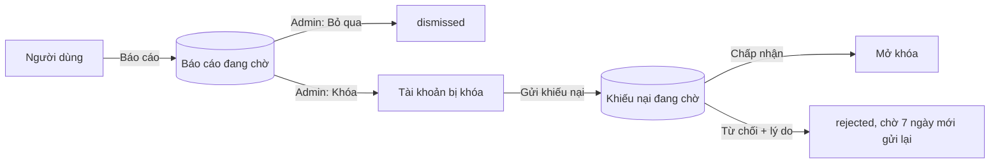

# P13-11 — Báo cáo vi phạm và khiếu nại khóa tài khoản (issue tổng)

**Trạng thái:** 🟡 Open (đã duyệt phạm vi ở P13-D109, 27/11/2026)
**Người phụ trách:** PM/leader (theo dõi các issue con)
**Ước lượng:** 12 points, chia thành 5 issue con
**Phụ thuộc:** P13-09 (danh sách loại vi phạm)
**Repo:** `Identity-Service`, `api-docs`, `fe`, `mobile`

> Tên file giữ nguyên để không gãy link cũ. Issue này không có PR riêng; xong khi mọi issue con xong.

## Vì sao cần

- Admin cần căn cứ trước khi khóa: hiện chỉ có ô lý do tự do, không có nơi người dùng báo cáo vi phạm.
- Người bị khóa nhầm chưa có cách xin mở khóa trong app. FE web hiện đưa tài khoản bị khóa về trang `/forbidden` chung, và `GET /me` không trả lý do khóa.

## Issue con

| ID | Nội dung | Repo | Ước lượng | Phụ thuộc |
|---|---|---|---|---|
| [P13-15](P13-15-be-account-appeal.md) | BE: Khiếu nại khóa tài khoản | `Identity-Service`, `api-docs` | 3 points | — |
| [P13-16](P13-16-be-user-report.md) | BE: Báo cáo vi phạm | `Identity-Service`, `api-docs` | 2 points | P13-15 |
| [P13-17](P13-17-fe-account-appeal.md) | FE: Trang tài khoản bị khóa, form khiếu nại, hàng chờ khiếu nại | `fe` | 2 points | P13-15 |
| [P13-18](P13-18-fe-user-report.md) | FE: Gửi báo cáo, hàng chờ báo cáo | `fe` | 2 points | P13-16, P13-09 |
| [P13-19](P13-19-mobile-report-and-appeal.md) | Mobile: Khiếu nại và báo cáo (⏸ Blocked: mobile chưa có lớp mạng, đăng nhập, chat) | `mobile` | 3 points | P13-15, P13-16 |

## Câu hỏi đã chốt (P13-D109)

- [x] Có làm báo cáo vi phạm, hay chỉ làm khiếu nại? → **Làm cả hai.**
- [x] Thời gian xử lý mục tiêu hiển thị cho người khiếu nại? → **"Thường xử lý trong 3 ngày làm việc"**, chỉ là chữ hiển thị.
- [x] Khoảng chờ gửi lại sau khi bị từ chối? → **7 ngày** tính từ lúc bị từ chối, trong cùng kỳ khóa.
- [x] Module đặt ở Identity hay community? File đính kèm dùng module media nào? → **Identity-Service**, dùng module `media` của Identity.
- [x] Mobile có làm trong cùng đợt không? → **Không**, tách thành P13-19.

## Luồng tổng quát

## Definition of Done

- [ ] P13-15 → P13-19 đều Done.
- [ ] Demo end-to-end trên web: landlord báo cáo tenant → admin khóa từ báo cáo → tenant (web) thấy lý do khóa và gửi khiếu nại → admin từ chối → tenant thấy lý do và ngày được gửi lại → admin chấp nhận lần sau → tài khoản hoạt động lại, có thông báo và email.
