# Identity — Sequence diagram theo API

Bản vẽ **thiết kế đích** cho 17 API của Identity (15 API đã build + refresh/logout đang làm), dùng để gắn vào `api-docs` sau khi review.

**Cơ sở:**
- Bảng API, dữ liệu ngoài và event đã chốt.
- Event dùng RabbitMQ, exchange `pbl6.events` (D54); catalogue ở `pm/phase-3/discovery/microservices-architecture.md` §5.7.
- Payload event dùng đúng tên field của entity/DTO.

## 0. Phần chung (không lặp lại trong từng diagram)

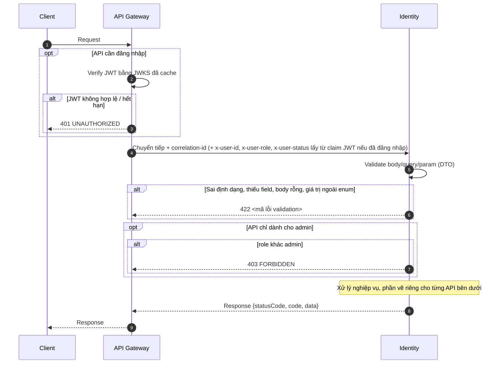

Từng diagram bên dưới **bắt đầu từ lúc API Gateway chuyển request vào Identity**, sau khi đã qua các bước chung ở trên.
- **Không vẽ lại:** Client, verify JWT, validate DTO (422), kiểm tra role admin (403).
- **Chỉ vẽ:** các kiểm tra nghiệp vụ cần dữ liệu (DB hoặc service khác).

**Quy ước vẽ:**
- **Participant:** `API Gateway`, `Identity`, `Identity DB`, `RabbitMQ`, `Tenancy`, `Community`, `Payment`. Mỗi diagram chỉ có những participant thật sự tham gia.
- **Response:** mọi response, kể cả lỗi, vẽ `Identity → API Gateway`.
- **Publish event:** Identity ghi event vào outbox **cùng transaction** với thay đổi dữ liệu. Diagram không vẽ outbox relay, chỉ vẽ `Identity -) RabbitMQ` sau khi commit.
- **Mũi tên:** `-)` là bất đồng bộ (event), `->>` là đồng bộ (HTTP/DB).
- **Soft delete:** user bị xóa vẫn còn dòng trong bảng `users` với `is_deleted = true`. Mọi truy vấn "tìm user" chỉ lấy user **chưa bị xóa**, nên user đã xóa được xử lý như không tồn tại.
- **Khóa và xóa tài khoản:**
  - User bị **khóa** vẫn đăng nhập được. Access token mang claim `{sub, role, status}`, nên token cấp sau khi khóa có `status=locked`. API Gateway gắn header `x-user-status` cho mọi service. Tenancy và Community đọc header này để chặn chức năng theo `shared_user_flow.md` §1.3, không lưu bản sao `status` (`microservices-architecture.md` §6.2).
  - Event `user.locked` / `user.unlocked` chỉ dùng để Tenancy/Community đổi **dữ liệu của chính mình** (ẩn/hiện BĐS, tạm ngưng/khôi phục HĐ).
  - Token cấp trước khi khóa/mở khóa vẫn mang `status` cũ tới khi hết hạn (tối đa 15 phút).
  - User bị **xóa** thì không đăng nhập được.

---

## 1. Auth

### 1.1 `POST /auth/register` — Đăng ký

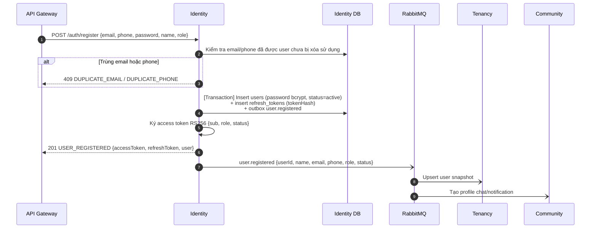

### 1.2 `POST /auth/login` — Đăng nhập

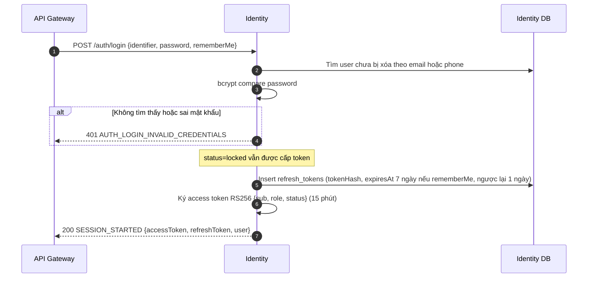

### 1.3 `POST /auth/password-reset-requests` — Yêu cầu đặt lại mật khẩu

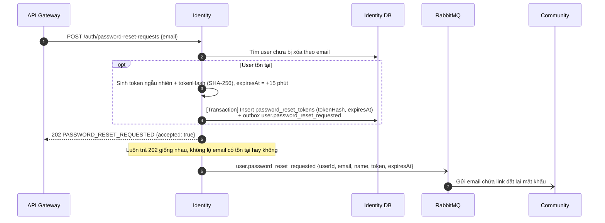

### 1.4 `POST /auth/password-resets` — Đặt lại mật khẩu bằng token

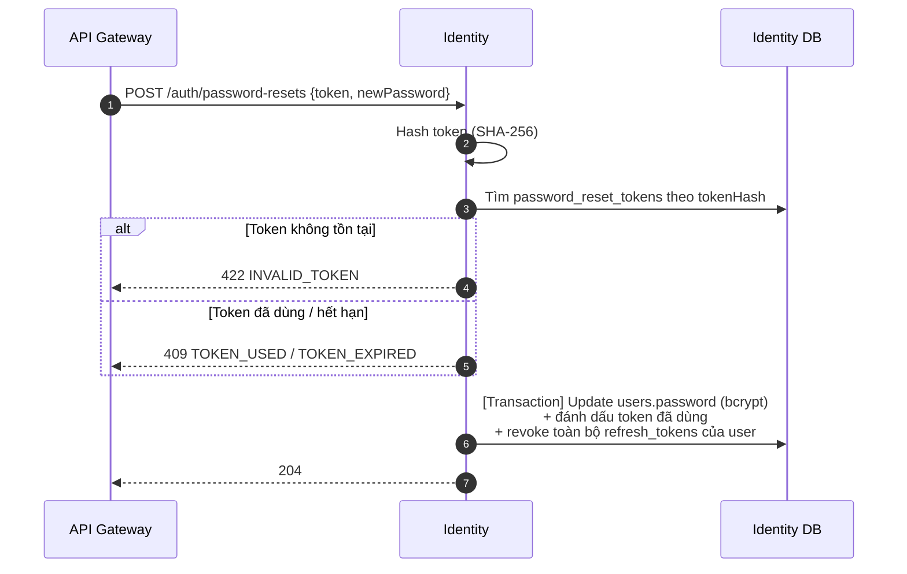

### 1.5 `POST /auth/refresh` — Làm mới access token *(P4-04, đang làm)*

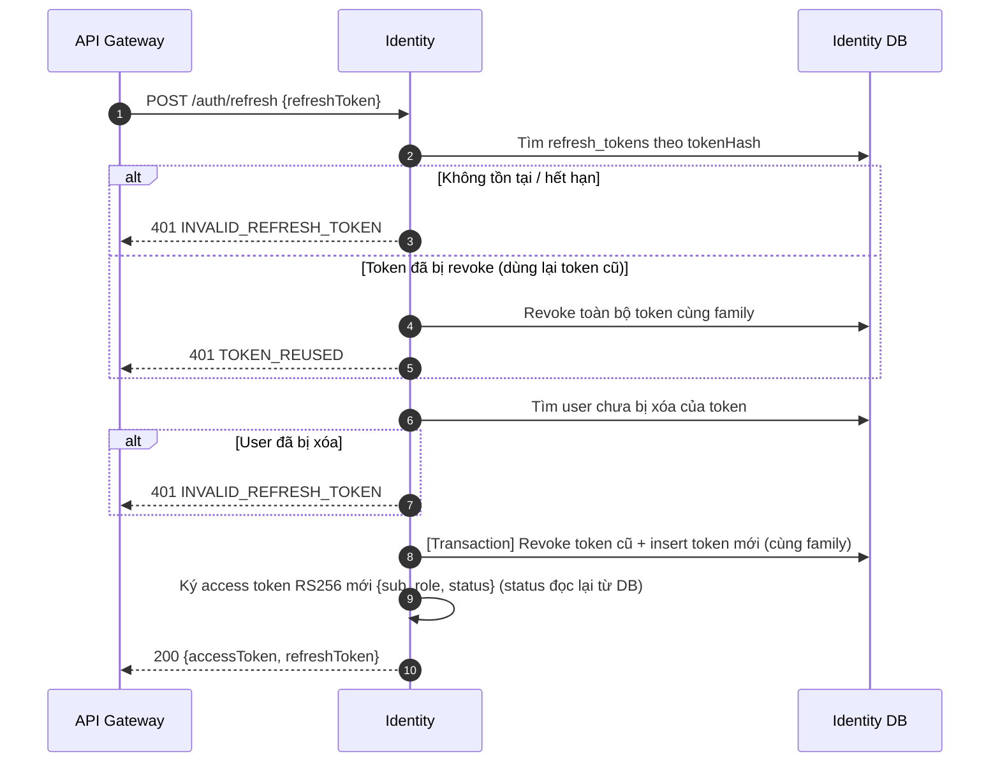

### 1.6 `POST /auth/logout` — Đăng xuất *(P4-04, đang làm)*

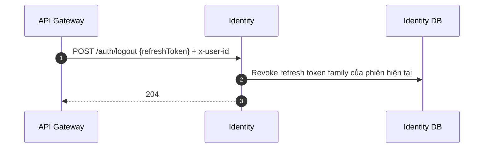

### 1.7 `GET /.well-known/jwks.json` — Public key để verify JWT

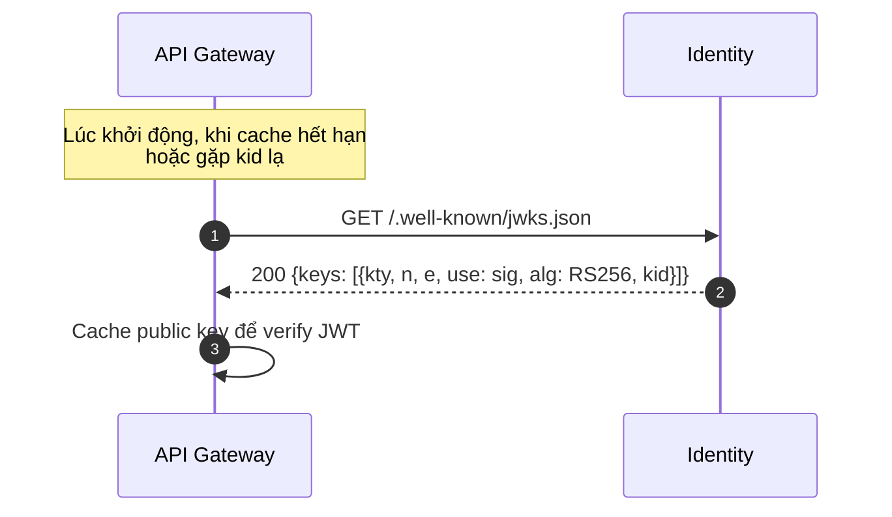

### 1.8 `GET /identity/health` — Health check

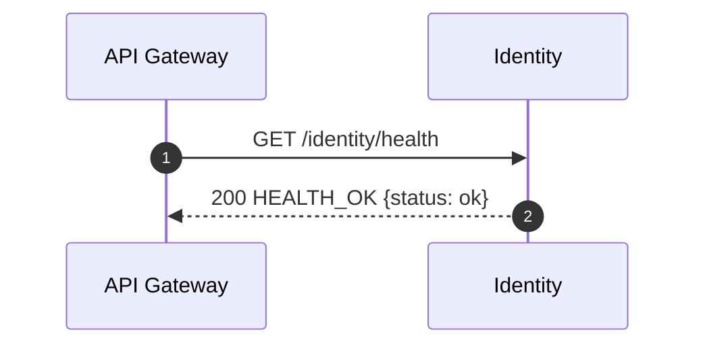

---

## 2. Me (tài khoản của chính mình)

### 2.1 `GET /me` — Xem hồ sơ

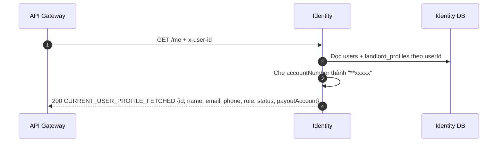

### 2.2 `PATCH /me` — Cập nhật hồ sơ

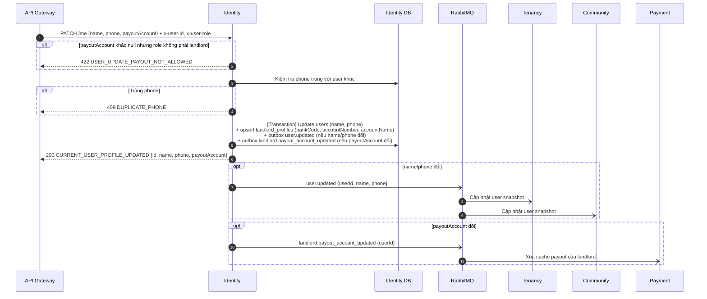

### 2.3 `PUT /me/password` — Đổi mật khẩu

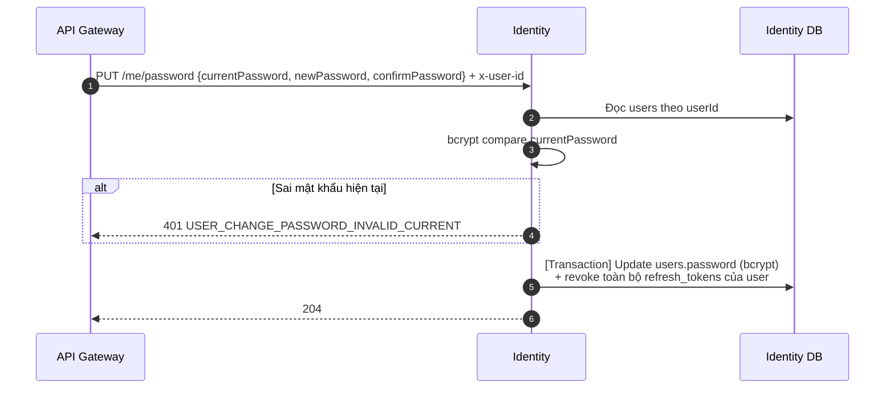

---

## 3. Admin users

### 3.1 `GET /users` — Danh sách người dùng

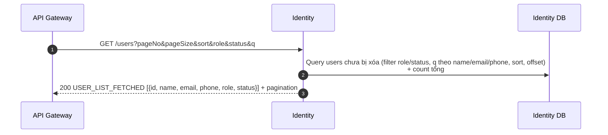

### 3.2 `GET /users/:userId` — Chi tiết người dùng

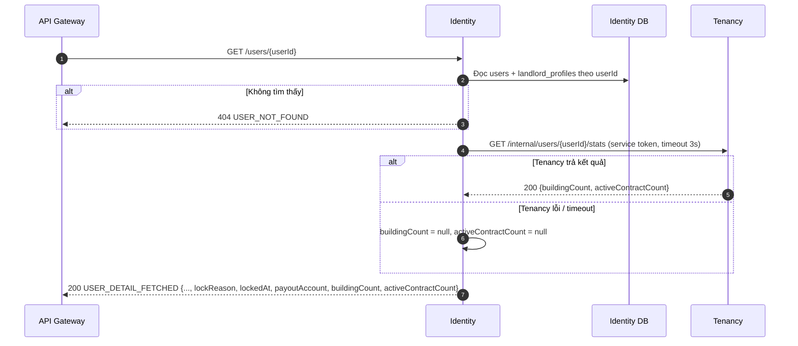

### 3.3 `PATCH /users/:userId` — Admin sửa thông tin người dùng

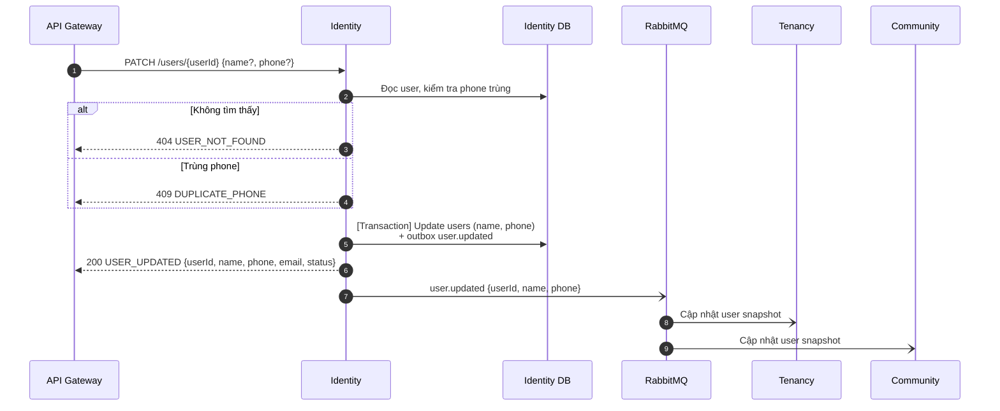

### 3.4 `POST /users/:userId/lock` — Khóa tài khoản

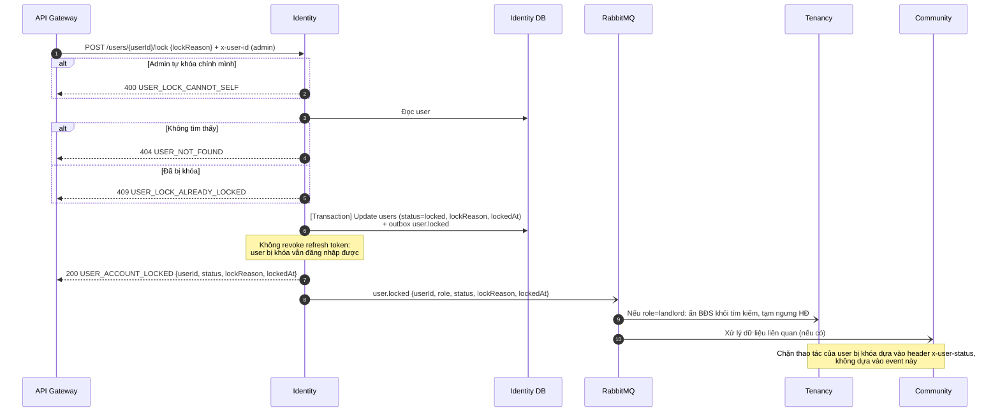

### 3.5 `POST /users/:userId/unlock` — Mở khóa tài khoản

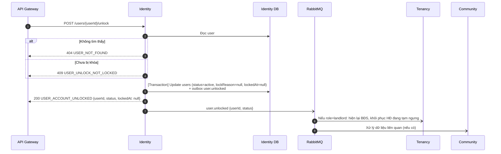

### 3.6 `DELETE /users/:userId` — Xóa mềm tài khoản

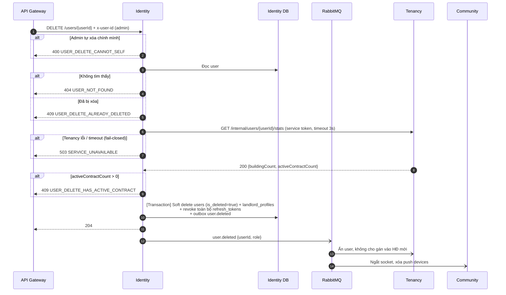

---

## 4. Chỗ diagram lệch so với code hiện tại

Diagram vẽ theo thiết kế đã chốt. Những điểm dưới đây cần sửa code để khớp.

| # | Chỗ lệch | Vị trí | Cần làm |
|---|----------|--------|---------|
| 1 | ✅ Đã sửa: 7 event được ghi outbox cùng transaction (register, reset request, update me/admin, lock, unlock, delete). Tạm đặt `RABBITMQ_PUBLISH_MANDATORY=false` vì chưa có consumer bind `user.*`; bật lại khi Tenancy/Community subscribe | Các command handler trong `Identity-Service/src/modules/{auth,users}` | — |
| 2 | ✅ Đã sửa: lock không còn revoke refresh token | `auth-revoke-tokens-on-user-events.event.handler.ts` | — |
| 3 | ✅ Đã sửa: user bị khóa được yêu cầu reset mật khẩu | `password-reset-request.command.handler.ts` | — |
| 4 | ✅ Đã sửa: thay TODO bằng event `user.password_reset_requested` | `password-reset-request.command.handler.ts` | Community cần consumer gửi email |
| 5 | `buildingCount`, `activeContractCount` hard-code 0. Xóa user chưa kiểm tra HĐ hiệu lực | `user-get-detail-admin.query.handler.ts`, `user-delete.command.handler.ts` | Gọi `GET /internal/users/{userId}/stats` của Tenancy (Tenancy cần build endpoint này) |
| 6 | Access token chỉ có `{sub, role}`, Gateway chưa gắn `x-user-status` | `Identity-Service/src/modules/auth` (ký token), `api-gateway` (forward header) | Thêm claim `status`, Gateway gắn header `x-user-status` |
| 7 | Delete chưa có mã `409 USER_DELETE_HAS_ACTIVE_CONTRACT`, `503 SERVICE_UNAVAILABLE` | `user-delete.command.handler.ts`, `api-docs/src/paths/users/user-by-id.yaml` | Bổ sung mã lỗi vào code và api-docs |
