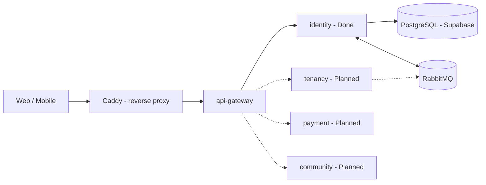
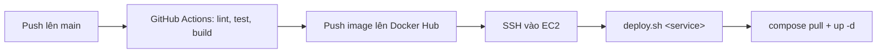
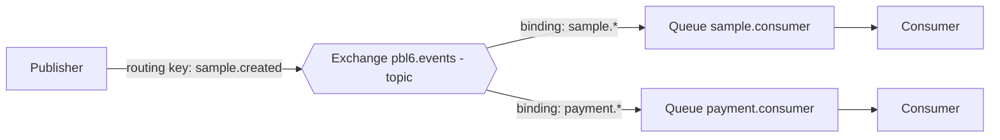
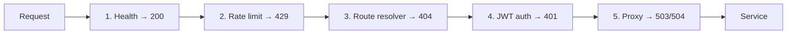
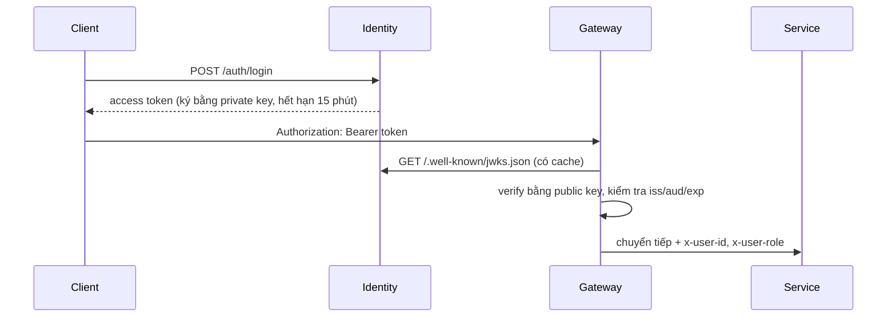
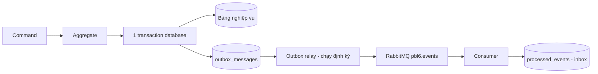

# Nội dung thuyết trình — Kiến trúc Backend & Tiến độ Phase 4

> **Mục đích:** nội dung nguồn để dựng deck slide.
> **Người trình bày:** leader nhóm. **Người nghe:** team member (FE, Mobile, BE) và giảng viên hướng dẫn.
> **Thời lượng:** khoảng 40 phút cho phần chính và 5 phút Q&A. Nếu chỉ có 30 phút thì cắt theo Phụ lục A.
> **Thứ tự:** Bối cảnh & big picture → Lý thuyết (Infra/RabbitMQ → API Gateway → Clean Architecture/DDD → Transactional Outbox) → Trạng thái repo → Vấn đề, next steps, thảo luận.
> **Dữ liệu trạng thái:** chốt ngày 2026-10-21, lấy từ git log và code của từng repo. Không lấy từ bảng issue Phase 4 vì bảng này chưa được cập nhật.
> **Quyết định kiến trúc:** trích từ `pm/phase-3/discovery/decisions.md` (D52–D59) và `microservices-architecture.md`.
>
> **Nhãn trạng thái dùng trong file:** `[Done]` đã chạy · `[In progress]` đang làm hoặc làm một phần · `[Planned]` chưa bắt đầu · `[Cần xác minh]` là suy luận từ cấu hình, chưa kiểm chứng thực tế.
>
> **Cấu trúc mỗi slide:** Tiêu đề (là thông điệp chính) · Nội dung trên slide · Speaker notes (thông điệp, lời nói, thuật ngữ, chuyển tiếp, thời gian, câu hỏi dự kiến).

---

## PHẦN 0 — MỞ ĐẦU

### Slide 1 — Title

- **Rentify — Kiến trúc Backend & Tiến độ Phase 4**
- Hệ thống quản lý nhà trọ: web cho chủ trọ/admin, app mobile cho người thuê
- Nhóm PBL6 · Người trình bày: _<tên leader>_ · 2026-10-21

**Speaker notes**
- **Thông điệp:** buổi này vừa báo cáo tiến độ, vừa chia sẻ kiến thức nền mà cả nhóm cần nắm.
- **Lời nói:** Giới thiệu nhanh bản thân và vai trò leader. Nói rõ hôm nay có hai phần: phần kỹ thuật để cả team hiểu chung kiến trúc, và phần tiến độ để thầy/cô nắm nhóm đang ở đâu.
- **Thời gian:** 0.5 phút.

### Slide 2 — Agenda

1. Bối cảnh & kiến trúc tổng thể
2. Hạ tầng & RabbitMQ
3. API Gateway
4. Clean Architecture & DDD
5. Transactional Outbox
6. Trạng thái các repo
7. Vấn đề, next steps & thảo luận

**Speaker notes**
- **Thông điệp:** phần lý thuyết đi trước để phần tiến độ có ngữ cảnh.
- **Chuyển tiếp:** "Trước khi đi vào chi tiết, đây là bức tranh tóm tắt trong một slide."
- **Thời gian:** 0.5 phút.

### Slide 3 — Executive Summary: hạ tầng và nền tảng đã chạy, nghiệp vụ là trọng tâm tiếp theo

| | Nội dung |
|---|---|
| **Giai đoạn** | Phase 4 (Core features, W9–12). Mốc tiếp theo là M4 (W11): demo feature-complete trên EC2 |
| **Đã đạt** | Hạ tầng chạy trên EC2. API Gateway có xác thực JWT RS256/JWKS. Identity-Service có auth và quản lý user. Boilerplate có sẵn Outbox/Inbox. Web có nền tảng routing theo role và base UI |
| **Vấn đề chính** | Luồng đăng nhập web chưa thông end-to-end: thiếu endpoint refresh/logout, lệch path profile, nghi lỗi API URL trên EC2 |
| **Trọng tâm tiếp theo** | Sửa luồng auth end-to-end → bootstrap `tenancy-service` (Building, Room) theo pattern Outbox |

**Speaker notes**
- **Thông điệp:** nền móng đã xong, rủi ro lớn nhất bây giờ là tiến độ phần nghiệp vụ.
- **Lời nói:** Nhấn mạnh rằng các vấn đề được phát hiện qua việc chủ động rà code chéo giữa các repo, trước khi chúng ảnh hưởng tới demo.
- **Chuyển tiếp:** "Để hiểu vì sao kiến trúc như hiện tại, mình quay lại bài toán ban đầu."
- **Thời gian:** 1.5 phút.

---

## PHẦN 1 — BỐI CẢNH & BIG PICTURE

### Slide 4 — Vì sao chọn microservice: yêu cầu môn học, nhưng bị giới hạn bởi nguồn lực

**Problem → Analysis → Solution → Trade-offs**

- **Yêu cầu:** môn Kiến trúc hướng dịch vụ (SOA) yêu cầu đồ án có ít nhất 4 service.
- **Ràng buộc:** 13–14 tuần, 1 backend engineer, 1 máy chủ, chất lượng ở mức demo.
- **Quyết định (D52):** tách theo bounded context thành 4 service: `identity` · `tenancy` · `payment` · `community`.
- **Phương án bị loại:**

| Phương án | Lý do loại |
|---|---|
| Giữ modular monolith | Không đạt yêu cầu tối thiểu 4 service |
| 6–7 service (tách media, notification…) | Vượt sức 1 BE; số cặp event giữa các service tăng rất nhanh |
| 4 module trong 1 monorepo dùng chung `libs/` | Trông như microservice nhưng không tách ra triển khai độc lập được |

**Speaker notes**
- **Thông điệp:** số service được chọn ở mức tối thiểu đủ yêu cầu, có cân nhắc nguồn lực thật của nhóm.
- **Lời nói:** `tenancy` cố ý gộp Building, Room, Contract và Invoice để giữ chúng trong cùng một transaction ACID, thay vì phải làm Saga cho mọi thứ.
- **Thuật ngữ:** *Bounded context* là ranh giới mà trong đó một mô hình nghiệp vụ có nghĩa nhất quán.
- **Thời gian:** 1.5 phút.
- **Câu hỏi dự kiến:**
  - *"Một người làm 4 service có quá sức không?"* → Đây là rủi ro lớn nhất và đã được ghi nhận. Cách giảm: dùng chung boilerplate, làm tuần tự từng service theo sprint, fork thay vì viết lại từ đầu.
  - *"API Gateway có được tính là một service không?"* → Nhóm đang cần thầy/cô xác nhận (xem slide thảo luận).

### Slide 5 — Kiến trúc tổng thể: một cửa vào, mỗi service một database, giao tiếp qua event



- Client chỉ gọi qua **Caddy → API Gateway**, không bao giờ gọi thẳng vào service.
- **Database-per-service (D53):** mỗi service sở hữu dữ liệu riêng, không có foreign key giữa các service.
- **Đồng bộ:** HTTP/JSON. **Bất đồng bộ:** event qua RabbitMQ topic exchange (D54).

**Speaker notes**
- **Thông điệp:** ba nguyên tắc định hình toàn bộ thiết kế.
- **Lời nói:** Đi theo luồng một request từ trái sang phải. Chỉ ra rằng hiện tại mới có identity chạy thật, các service khác là đường nét đứt.
- **Thuật ngữ:** *Reverse proxy* là máy chủ đứng trước, nhận request rồi chuyển tiếp vào bên trong.
- **Chuyển tiếp:** "Các thành phần này nằm ở những repo nào?"
- **Thời gian:** 1.5 phút.

### Slide 6 — Bản đồ repo: mỗi service một repo, boilerplate là khuôn mẫu chung

| Repo | Vai trò | Stack |
|---|---|---|
| `infra` | Docker Compose, Caddy, script deploy | Docker, Caddy, Bash |
| `api-gateway` | Cửa vào API: JWT, routing, rate limit, proxy | NestJS (middleware) |
| `boilerplate` | Template service: Clean Architecture + DDD + Outbox | NestJS, TypeORM, RabbitMQ |
| `Identity-Service` | Auth, user, JWT RS256 + JWKS | NestJS |
| `fe` | Web cho chủ trọ và admin | React 19 + Vite |
| `api-docs` | Contract API (OpenAPI → Apidog) | OpenAPI |

**Speaker notes**
- **Thông điệp:** D58 quy định mỗi service một repo, không dùng thư viện chung. Boilerplate thay thế cho thư viện chung bằng cách fork.
- **Lời nói:** Trade-off ở đây: fork thì code bị lặp và có thể lệch phiên bản. Ví dụ thật: Identity fork boilerplate trước khi có Outbox, nên đến nay vẫn chưa có Outbox (sẽ nói ở phần trạng thái).
- **Thời gian:** 1 phút.

---

## PHẦN 2 — HẠ TẦNG & RABBITMQ

### Slide 7 — Hạ tầng: một EC2 + database cloud, đổi độ bền lấy chi phí bằng 0

- **AWS EC2 `t3.micro`** (1 GB RAM, Ubuntu) + **swap 2 GB**, toàn bộ chạy bằng **Docker Compose**.
- Container: `caddy`, `api-gateway`, `identity`, `web`, `rabbitmq` (chung network `rentify-net`).
- Database đặt ở **Supabase PostgreSQL** (free tier), không nằm trên EC2.

| Kế hoạch (D56) | Thực tế | Tác động |
|---|---|---|
| Tối thiểu `t3.small`, Postgres trong Compose | `t3.micro` + Supabase | Đưa DB ra ngoài nên đỡ được RAM cho EC2 |
| Chỉ mở 443 (HTTPS) | HTTP qua IP, chưa có domain | Chưa có TLS |

**Speaker notes**
- **Thông điệp:** đây là lựa chọn có ý thức để hợp ngân sách sinh viên, và chấp nhận rủi ro single point of failure.
- **Lời nói:** Swap 2 GB là lưới an toàn khi thiếu RAM. Chưa có số liệu đo RAM thực tế; khi thêm tenancy, payment, community cần đo lại để quyết định có nâng máy hay không.
- **Thuật ngữ:** *Swap* là dùng ổ đĩa làm RAM dự phòng, chậm hơn RAM nhưng tránh bị kill process vì hết bộ nhớ.
- **Thời gian:** 1 phút.
- **Câu hỏi dự kiến:** *"Nếu EC2 chết giữa buổi demo thì sao?"* → Đây là single point of failure đã được chấp nhận. Cách giảm: deploy sớm, có script dựng lại server (`setup-server.sh`, `deploy.sh`), và database nằm ngoài EC2 nên không mất dữ liệu.

### Slide 8 — Bảo mật mạng: Caddy là cửa duy nhất publish port

| Port public | Đi tới |
|---|---|
| `80` | `api-gateway` |
| `5173` | `web` (nginx) |
| `15672` | RabbitMQ Management UI, chỉ mở cho IP của team |

- Service backend chỉ dùng `expose` (nội bộ network), không dùng `ports`, nên **không ai bypass được gateway**.
- Không bao giờ mở 5672 (AMQP), 3000, 3001 trên Security Group.
- Caddy thêm security header: `nosniff`, `X-Frame-Options: DENY`, `Referrer-Policy`.

**Speaker notes**
- **Thông điệp:** lớp bảo vệ đầu tiên nằm ở mạng, trước cả code.
- **Thuật ngữ:** `ports` mở cổng ra máy host. `expose` chỉ cho các container cùng network nhìn thấy.
- **Chuyển tiếp:** "Code được đưa lên server này như thế nào?"
- **Thời gian:** 1 phút.

### Slide 9 — Deploy: mỗi repo tự build image, repo infra chỉ giữ cấu hình



- `deploy.sh` không tham số thì deploy cả stack; có tham số thì chỉ deploy service đó.
- Script hỗ trợ: cài Docker, tạo swap, sinh cặp khóa RSA cho JWT, đồng bộ user RabbitMQ cho từng service.
- `[Done]` FE deploy tự động hoàn toàn. `[In progress]` Backend có workflow nhưng vẫn có bước chạy `deploy.sh` thủ công.

**Speaker notes**
- **Thông điệp:** quy trình deploy lặp lại được, không thao tác tay trên server.
- **Lời nói:** Mỗi service có một user RabbitMQ riêng, để sau này có thể giới hạn quyền.
- **Thời gian:** 1 phút.

### Slide 10 — Vì sao cần message broker: gọi đồng bộ làm các service chết dây chuyền

| | Đồng bộ (HTTP) | Bất đồng bộ (broker) |
|---|---|---|
| Cách gọi | A gọi B và **chờ** | A gửi message rồi **đi tiếp** |
| Khi B chết | A lỗi theo | Message nằm chờ, B xử lý sau |
| Số người nhận | 1 | Nhiều service cùng nghe một event |
| Phù hợp | Cần kết quả ngay (lấy thông tin user) | Thông báo "điều đã xảy ra" (`user.deleted`) |

**Speaker notes**
- **Thông điệp:** broker giúp các service giảm phụ thuộc vào nhau (loose coupling).
- **Lời nói:** Ví dụ: khi một user bị xoá, identity chỉ cần phát `user.deleted`. Tenancy dọn hợp đồng, community dọn chat; identity không cần biết ai nghe.
- **Chuyển tiếp:** "RabbitMQ hoạt động như một bưu điện. Xem các thành phần của nó."
- **Thời gian:** 1 phút.

### Slide 11 — RabbitMQ: publisher gửi tới exchange, exchange dựa vào binding để chia vào queue



| Khái niệm | Hiểu đơn giản |
|---|---|
| **Exchange** | "Bưu điện": nhận message và quyết định đưa vào queue nào |
| **Routing key** | "Địa chỉ" ghi trên message, ví dụ `sample.created` |
| **Queue** | "Hộp thư": nơi message chờ được xử lý |
| **Binding** | Luật nối exchange với queue |
| **ACK** | Consumer báo đã xử lý xong, lúc đó message mới bị xoá |

**Speaker notes**
- **Thông điệp:** publisher không bao giờ gửi thẳng vào queue.
- **Lời nói:** Nhờ đó publisher không cần biết ai đang nghe. Thêm consumer mới chỉ cần tạo queue và binding mới.
- **Thời gian:** 1.5 phút.
- **Câu hỏi dự kiến:** *"Nếu consumer chết trước khi ACK thì sao?"* → Message quay lại queue và được giao lại. Đây là lý do có thể nhận trùng, dẫn tới yêu cầu idempotent ở phần Outbox.

### Slide 12 — Topic exchange: định tuyến theo pattern, mỗi consumer một queue

- 3 loại exchange chính: **direct** (khớp chính xác), **fanout** (gửi cho tất cả), **topic** (khớp theo pattern).
- Dự án dùng **một topic exchange durable `pbl6.events`**, routing key dạng `<aggregate>.<action>`.
- Wildcard: `*` khớp đúng 1 từ, `#` khớp 0 hoặc nhiều từ.
  - `sample.*` khớp `sample.created` và `sample.deleted`
  - `#.deleted` khớp `user.deleted` và `room.deleted`
- **Queue-per-consumer:** mỗi service nghe có queue riêng, nên một event đến được nhiều service.

**Speaker notes**
- **Thông điệp:** topic exchange đủ linh hoạt cho mọi luồng event của dự án mà chỉ cần một exchange.
- **Thuật ngữ:** *Durable* nghĩa là exchange hoặc queue vẫn còn sau khi RabbitMQ khởi động lại.
- **Thời gian:** 1 phút.

### Slide 13 — Vì sao RabbitMQ: có sẵn DLQ và đủ nhẹ để chạy trên 1 máy

| Tiêu chí | RabbitMQ | Kafka | MQTT | Redis Streams |
|---|---|---|---|---|
| Dead-letter queue | Có sẵn | Phải tự xây | Không có | Phải tự xây |
| Routing linh hoạt | direct/topic/fanout | Theo partition | Chỉ topic | Theo stream |
| Tài nguyên trên 1 máy nhỏ | Nhẹ | Nặng (JVM + disk) | Nhẹ nhất | Nhẹ |
| Có trong tài liệu môn | Có | Có | Không | Không |

- **Quyết định (D54):** RabbitMQ.
- **Đánh đổi:** RabbitMQ có thể giao trùng message, nên consumer bắt buộc phải idempotent.

**Speaker notes**
- **Thông điệp:** lựa chọn dựa trên nhu cầu thật (DLQ, retry, 1 máy), không theo trào lưu.
- **Lời nói:** MQTT phù hợp với thiết bị IoT, nhưng dự án không có thiết bị đo thông minh nào. Kafka mạnh khi lưu log lâu dài với thông lượng lớn, nhưng quá nặng cho một EC2 nhỏ.
- **Thời gian:** 1 phút.
- **Câu hỏi dự kiến:** *"Vì sao không dùng Kafka cho quen thuộc với doanh nghiệp?"* → Dự án không cần lưu và phát lại log; DLQ và routing mới là nhu cầu chính, và tài nguyên máy không đủ cho Kafka.

### Slide 14 — Khi consumer lỗi: retry có độ trễ, quá số lần thì vào DLQ

```text
sample.consumer ──lỗi──> sample.consumer.retry (chờ TTL) ──hết TTL──> quay lại sample.consumer
       │
       └── quá số lần thử ──> sample.consumer.dlq (kèm lý do lỗi)
```

- **Retry queue:** message lỗi được đặt lại sau một khoảng delay, tránh vòng lặp lỗi liên tục.
- **DLQ (Dead Letter Queue):** nơi giữ message lỗi quá số lần để kiểm tra thủ công, không bị mất.
- Delivery là **at-least-once**: một message có thể đến **hơn một lần**.

**Speaker notes**
- **Thông điệp:** hệ thống không mất message lỗi, nhưng phải chấp nhận nhận trùng.
- **Lời nói:** Không dùng requeue ngay lập tức, vì message lỗi sẽ quay vòng liên tục và chiếm CPU.
- **Chuyển tiếp:** "Message đi qua RabbitMQ đã an toàn. Nhưng request từ client đi vào hệ thống thế nào? Đó là việc của API Gateway."
- **Thời gian:** 1 phút.

---

## PHẦN 3 — API GATEWAY

### Slide 15 — API Gateway chỉ làm phần việc chung, không chạm vào dữ liệu nghiệp vụ

| Gateway làm | Service backend làm |
|---|---|
| Kiểm tra token hợp lệ, xác định ai đang gọi | Kiểm tra role (đọc header `x-user-role`) |
| Xác định path thuộc service nào | Kiểm tra quyền sở hữu dữ liệu (phòng này của ai) |
| Giới hạn số request theo IP | Validate input, xử lý nghiệp vụ |

- **Nguyên tắc:** việc gì cần dữ liệu nghiệp vụ thì không đặt ở gateway.

**Speaker notes**
- **Thông điệp:** tách bạch trách nhiệm để gateway luôn mỏng và nhanh.
- **Lời nói:** Gateway không biết phòng 42 thuộc chủ trọ nào; việc đó tenancy tự kiểm tra.
- **Thời gian:** 1 phút.

### Slide 16 — Chuỗi 5 middleware: thứ tự được chọn để chặn request lỗi càng sớm càng rẻ



- **Rate limit đứng trước JWT:** chặn flood trước khi tốn CPU verify chữ ký.
- **Routing đứng trước auth:** path sai trả 404 rõ ràng, thay vì 401 gây hiểu nhầm.

**Speaker notes**
- **Thông điệp:** thứ tự middleware là một quyết định thiết kế, không phải ngẫu nhiên.
- **Lời nói:** Đi qua ví dụ `GET /api/v1/rooms/42`: qua rate limit, khớp prefix `/rooms` nên đi tenancy, verify token, rồi proxy sang kèm header thông tin user.
- **Thời gian:** 1.5 phút.

### Slide 17 — Routing theo prefix: path được giữ nguyên khi chuyển tiếp

| Service | Prefix (`/api/v1/...`) |
|---|---|
| identity | `/auth`, `/users`, `/me`, `/.well-known` |
| tenancy | `/buildings`, `/rooms`, `/contracts`, `/invoices` |
| payment | `/payments` |
| community | `/chat` |

- Khớp theo **nguyên segment**, prefix dài nhất thắng.
- Path giữ nguyên, nên mọi service dùng chung `setGlobalPrefix('api/v1')`, không thêm tên service vào path.
- Path public (không cần token): register, login, password reset, JWKS, `/health`.

**Speaker notes**
- **Thông điệp:** quy ước path thống nhất giúp thêm service mới chỉ cần thêm một dòng cấu hình.
- **Lời nói:** Đây là lý do identity vừa bỏ prefix `identity-service` khỏi path. Ai làm tenancy thì đăng ký prefix vào bảng này.
- **Thời gian:** 1 phút.

### Slide 18 — JWT RS256 + JWKS: chỉ identity ký được, ai cũng verify được



| | HS256 (khóa đối xứng) | **RS256 (khóa bất đối xứng)** |
|---|---|---|
| Khóa | 1 secret dùng chung để ký và verify | Private key để ký, public key để verify |
| Service khác cần biết | Secret, nên cũng ký giả được | Chỉ public key, không ký được |

- Chỉ chấp nhận thuật toán `RS256`, nên chặn được tấn công `alg: none`.
- Header `x-user-*` do client tự gửi bị xoá; gateway gắn lại từ token.

**Speaker notes**
- **Thông điệp:** RS256 phù hợp microservice vì chỉ một nơi giữ bí mật.
- **Thuật ngữ:** *JWKS (JSON Web Key Set)* là URL công bố public key; trường `kid` cho phép xoay khóa mà không làm gãy token cũ.
- **Thời gian:** 1.5 phút.
- **Câu hỏi dự kiến:**
  - *"Token bị lộ thì sao?"* → Access token chỉ sống 15 phút. Refresh token lưu trong database và bị thu hồi khi user bị khoá, xoá hoặc đổi mật khẩu.
  - *"Vì sao service backend tin header `x-user-id`?"* → Service không publish port ra ngoài, request chỉ có thể đến từ gateway, và gateway luôn xoá header giả trước khi gắn header thật.

### Slide 19 — Proxy & rate limit: đã đủ cho demo, giới hạn đã được ghi nhận

- **Proxy:** stream body (không buffer, nên upload file không bị hỏng), gắn `x-correlation-id` để trace một request qua nhiều service.
- Lỗi phía service: service tắt trả **503**, quá thời gian trả **504**.
- **Rate limit fixed window theo IP:** `/auth/*` 10 request/phút, còn lại 120 request/phút, có header `Retry-After`.

| Giới hạn hiện tại | Khi nào cần xử lý |
|---|---|
| Chưa proxy WebSocket | Trước khi làm chat (community) |
| Rate limit lưu trong bộ nhớ, chỉ đúng với 1 instance | Khi chạy nhiều instance gateway |
| CORS đang cho mọi origin | Khi có domain thật |
| Chưa có test tự động | Phase 5 |

**Speaker notes**
- **Thông điệp:** biết rõ giới hạn của mình và biết khi nào cần xử lý.
- **Lời nói:** Ngày demo cả lớp có thể dùng chung một IP NAT, nên cần nâng limit của auth (khoảng 50) để không tự chặn mình.
- **Chuyển tiếp:** "Request đã vào tới service. Bên trong một service, code được tổ chức thế nào?"
- **Thời gian:** 1 phút.

---

## PHẦN 4 — CLEAN ARCHITECTURE & DDD

### Slide 20 — Clean Architecture: phụ thuộc chỉ hướng vào trong, domain không biết framework

```text
Presentation → Application (use-case) → Domain
       ↓                ↓
Infrastructure ─────────┘   (implement các interface do Domain/Application định nghĩa)
```

| Layer | Chứa gì | Ví dụ trong code |
|---|---|---|
| **Domain** | Luật nghiệp vụ thuần, không import NestJS/TypeORM | `User.lock()`, `IUserRepository` |
| **Application** | Command/Query handler, ranh giới transaction | `UserLockCommandHandler` |
| **Infrastructure** | TypeORM, RabbitMQ, các adapter | `UserRepository` (TypeORM) |
| **Presentation** | Controller, DTO request/response | `UserAdminController` |

**Speaker notes**
- **Thông điệp:** đổi database hay broker thì domain không phải sửa.
- **Lời nói:** Domain là trái tim; infrastructure như phích cắm, có thể thay.
- **Thời gian:** 1.5 phút.
- **Câu hỏi dự kiến:** *"Với đồ án nhỏ, Clean Architecture có thừa không?"* → Có chi phí: nhiều file và mapper hơn. Đổi lại, cả team viết theo một khuôn, và tenancy/payment có thể fork boilerplate rồi làm ngay.

### Slide 21 — Port & Adapter: handler chỉ biết interface, DI token nối với implementation

```text
modules/users/
├── domain/          entities, value-objects, repositories (interface), exceptions
├── use-case/        commands/, queries/, events/
├── infra/           persistence (ORM entity + repository), mappers
├── presentation/    controllers, request/, response/
└── users.di-token.ts · users.module.ts
```

```ts
constructor(
  @Inject(USERS_DI_TOKEN.REPOSITORY)
  private readonly userRepository: IUserRepository,   // port, không phải TypeORM
) {}
```

**Speaker notes**
- **Thông điệp:** cấu trúc thư mục phản ánh trực tiếp các layer.
- **Thuật ngữ:** *Port* là interface do domain định nghĩa. *Adapter* là class ở infra implement interface đó. *DI token* là Symbol dùng để NestJS biết inject class nào vào interface.
- **Thời gian:** 1 phút.

### Slide 22 — DDD: luật nghiệp vụ nằm trong entity, không rải rác trong service

| Khái niệm | Ý nghĩa | Trong code |
|---|---|---|
| **Entity** | Có định danh và vòng đời | `User`, `RefreshToken` |
| **Value Object** | Định nghĩa bằng giá trị, bất biến | `Uuid`, `RetryPolicy` |
| **Aggregate Root** | Cửa duy nhất để thay đổi một cụm entity, phát domain event | `SampleEntity extends AggregateRoot` |
| **Domain Event** | "Điều đã xảy ra" trong domain | `SampleCreatedEvent` |
| **Repository** | Lưu/lấy aggregate, giấu chi tiết database | `IUserRepository` |

```ts
lock(reason: string): void {
  if (this._status === UserStatus.LOCKED) throw new UserLockAlreadyLockedException();
  this._status = UserStatus.LOCKED;
}
```

**Speaker notes**
- **Thông điệp:** entity tự bảo vệ quy tắc của nó.
- **Lời nói:** Anti-pattern cần tránh là *anemic entity*: entity chỉ có getter/setter, còn luật nằm trong service. `create()` dùng khi tạo mới và có phát event; `reconstitute()` dùng khi đọc từ database và không phát lại event cũ.
- **Thời gian:** 1.5 phút.

### Slide 23 — CQRS nhẹ và 4 loại message: EventBus của NestJS không phải message broker

- **Command** thay đổi state (CommandBus); **Query** chỉ đọc (QueryBus). Hai bên dùng chung database, chưa có read model riêng.

| Loại | Phạm vi | Đi qua |
|---|---|---|
| Command | Trong service | CommandBus |
| Domain event | Trong aggregate | `pullDomainEvents()` |
| CQRS `EventBus` event | Trong cùng process | EventBus (trong bộ nhớ) |
| Integration event | Giữa các service | **Outbox → RabbitMQ** |

- `EventBus` **không lưu bền và không gắn với transaction**: process chết là mất event.

**Speaker notes**
- **Thông điệp:** dùng đúng loại message cho đúng phạm vi.
- **Lời nói:** Identity hiện dùng EventBus để revoke refresh token khi user bị khoá; việc này nội bộ nên đúng. Nhưng event gửi sang service khác bắt buộc đi qua Outbox. Vì sao? Slide tiếp theo.
- **Thuật ngữ:** *CQRS* là tách luồng ghi (command) và luồng đọc (query).
- **Thời gian:** 1 phút.

---

## PHẦN 5 — TRANSACTIONAL OUTBOX

### Slide 24 — Bài toán dual-write: ghi database và gửi event không thể atomic

Một command cần làm hai việc: `UPDATE database` và `PUBLISH RabbitMQ`.

| Tình huống | Hậu quả |
|---|---|
| Database commit, app chết trước khi publish | **Mất event** |
| Publish xong, database rollback | Consumer nhận **event ma** |
| Broker tạm sập | Request nghiệp vụ **lỗi theo broker** |

- Database và RabbitMQ là hai hệ thống khác nhau, **không có transaction chung**.

**Speaker notes**
- **Thông điệp:** đây là lỗi mất dữ liệu âm thầm, rất khó phát hiện khi test.
- **Lời nói:** Ví dụ: tạo phòng thành công nhưng event `room.created` bị mất, thì service khác không bao giờ biết phòng đó tồn tại.
- **Thời gian:** 1.5 phút.

### Slide 25 — Outbox: ghi event vào database cùng transaction, gửi sau



```ts
return this.unitOfWork.run(async (context) => {
  const sample = SampleEntity.create(command);
  await sampleRepository.save(sample, context);
  const messages = sample.pullDomainEvents().map(OutboxMessage.fromDomainEvent);
  await outboxRepository.append(messages, context);   // cùng transaction
  return sample;
});
```

**Speaker notes**
- **Thông điệp:** biến hai thao tác trên hai hệ thống thành một transaction trên một database.
- **Lời nói:** Không publish ngay, mà "bỏ thư vào hộp outbox" trong cùng transaction. Relay đóng vai bưu tá, đi gửi sau. Nếu bất kỳ bước nào lỗi, cả dữ liệu và event cùng rollback.
- **Thời gian:** 2 phút.
- **Câu hỏi dự kiến:** *"Relay publish xong nhưng chết trước khi đánh dấu PUBLISHED thì sao?"* → Relay sẽ gửi lại, nên có thể trùng. Vì vậy cần inbox ở phía nhận (slide 27).

### Slide 26 — Relay: claim có khóa, retry có backoff, giữ thứ tự theo aggregate

```text
PENDING → PROCESSING → PUBLISHED
              ↓ (lỗi)
           PENDING (chờ backoff) → … → FAILED (chặn các event sau của cùng aggregate)
```

1. Claim row bằng `FOR UPDATE SKIP LOCKED`, nên nhiều instance không lấy trùng.
2. Mỗi aggregate tối đa 1 event mỗi batch, để giữ **thứ tự trong cùng aggregate**.
3. Publish với **publisher confirm** và `mandatory`: không có queue nào nhận thì coi là lỗi.
4. Lỗi thì retry với exponential backoff; quá số lần thì `FAILED`, sửa xong chạy lệnh requeue.

**Speaker notes**
- **Thông điệp:** relay được thiết kế để an toàn khi chạy nhiều instance và khi broker chập chờn.
- **Lời nói:** Không hứa thứ tự toàn cục, chỉ hứa thứ tự trong một aggregate (các event của cùng phòng 42 đi đúng thứ tự).
- **Thuật ngữ:** *Publisher confirm* là broker xác nhận đã nhận message. *Exponential backoff* là thời gian chờ giữa các lần retry tăng dần (1s, 2s, 4s…).
- **Thời gian:** 1.5 phút.

### Slide 27 — Inbox: consumer ghi `messageId` để không xử lý trùng

- Outbox đảm bảo **at-least-once**, **không** phải exactly-once.
- Consumer ghi `messageId` vào bảng `processed_events` **cùng transaction** với nghiệp vụ:

```ts
await unitOfWork.run(async (context) => {
  const isNew = await inbox.recordIfNew(event.id, event.eventType, context);
  if (!isNew) return;              // đã xử lý rồi → bỏ qua
  await businessHandler.handle(event, context);
});
```

- Dùng unique constraint với `INSERT … ON CONFLICT DO NOTHING`, nên hai consumer nhận cùng lúc cũng không bị race condition.

**Speaker notes**
- **Thông điệp:** Outbox (phía gửi) + Inbox (phía nhận) + Retry/DLQ: không mất event, không xử lý trùng.
- **Thuật ngữ:** *Idempotent* nghĩa là xử lý một lần hay nhiều lần thì kết quả vẫn như nhau.
- **Thời gian:** 1 phút.

### Slide 28 — Trade-off: vì sao chọn Outbox thay vì các cách khác

| Phương án | Ưu điểm | Nhược điểm | Kết luận |
|---|---|---|---|
| Publish trực tiếp sau khi commit | Đơn giản | Mất event hoặc event ma | Loại |
| `EventBus` của NestJS | Có sẵn | Chỉ trong bộ nhớ, không gửi sang service khác | Chỉ dùng cho việc nội bộ |
| 2PC / distributed transaction | Nhất quán mạnh | RabbitMQ không hỗ trợ tốt, phức tạp, chậm | Loại |
| CDC (đọc log database, ví dụ Debezium) | Không cần relay trong code | Thêm hạ tầng nặng (Kafka Connect) | Quá sức với 1 máy |
| **Transactional Outbox** | Atomic với nghiệp vụ, không cần thêm hạ tầng | Thêm bảng, relay, độ trễ nhỏ, phải xử lý trùng | **Chọn (D59)** |

**Speaker notes**
- **Thông điệp:** Outbox là điểm cân bằng giữa độ tin cậy và độ phức tạp cho quy mô dự án.
- **Thời gian:** 1.5 phút.
- **Câu hỏi dự kiến:** *"Độ trễ của relay là bao nhiêu?"* → Phụ thuộc chu kỳ quét `OUTBOX_RELAY_INTERVAL_MS`. Chưa có số liệu đo thực tế; có thể đo trong Phase 5.

### Slide 29 — Checklist cho team: thêm một event mới

1. Tạo **domain event** trong module.
2. Aggregate gọi `addDomainEvent()` sau khi thay đổi thành công.
3. Command handler gọi `pullDomainEvents()` rồi `outbox.append()` **trong cùng `unitOfWork.run`**. Không gọi RabbitMQ hay `EventBus.publish()` thay cho bước này.
4. Đặt `eventType`/`routingKey` ổn định (ví dụ `room.created`), thêm version khi contract thay đổi.
5. Consumer khai báo routing key trong `defineConsumer({ routingKeys })`. **Bắt buộc**, nếu không event sẽ bị coi là unroutable, chuyển `FAILED` và chặn các event sau.
6. Consumer ghi inbox và xử lý nghiệp vụ trong một transaction.
7. Cập nhật tài liệu event contract.

**Speaker notes**
- **Thông điệp:** đây là quy trình chuẩn mà tenancy, payment, community sẽ làm theo.
- **Lời nói:** Bước 5 là lỗi dễ mắc nhất, cần nhấn mạnh.
- **Chuyển tiếp:** "Lý thuyết là vậy. Thực tế các repo đang ở đâu?"
- **Thời gian:** 1 phút.

---

## PHẦN 6 — TRẠNG THÁI CÁC REPO (chốt 2026-10-21)

### Slide 30 — Tổng quan tiến độ: nền tảng xong, nghiệp vụ mới bắt đầu

| Repo | Trạng thái | Kết quả kỹ thuật | Tác động |
|---|---|---|---|
| `infra` | [Done] | 5 container chạy trên EC2 sau Caddy | Có môi trường staging cho demo |
| `api-gateway` | [Done] | Đủ 5 middleware đã thiết kế | Có một cửa vào an toàn cho mọi service |
| `boilerplate` | [Done] | Clean Architecture + DDD + Outbox/Inbox | Service mới fork về là dùng được |
| `Identity-Service` | [In progress] | Auth, user, JWKS. Thiếu refresh/logout, chưa có Outbox | Login được, nhưng chưa duy trì phiên |
| `fe` | [In progress] | Routing theo role, base UI, deploy tự động | Có khung để lắp trang nghiệp vụ |
| `tenancy-service` | [Planned] | Chưa bắt đầu | Chặn luồng phòng, hợp đồng, hóa đơn |

**Speaker notes**
- **Thông điệp:** phần khó về hạ tầng và kiến trúc đã xong; rủi ro chuyển sang khối lượng nghiệp vụ.
- **Lời nói:** Nói thật với thầy/cô rằng bảng issue chính thức chưa phản ánh đúng tiến độ; bảng này lấy từ code thật.
- **Thời gian:** 1 phút.

### Slide 31 — infra & api-gateway

**infra**
- [Done] EC2 + swap + Docker; Caddy reverse proxy kèm security header.
- [Done] Script deploy từng service, sinh khóa RSA, đồng bộ user RabbitMQ.
- [Planned] Domain + HTTPS. Bỏ bước deploy backend thủ công.

**api-gateway**
- [Done] Health, rate limit, routing theo prefix, JWT RS256/JWKS, proxy + correlation ID, Dockerfile + workflow deploy.
- [Done] 6 trang tài liệu dạng tutorial cho team.
- [Planned] WebSocket proxy, giới hạn CORS origin, test tự động.

**Speaker notes**
- **Thời gian:** 1 phút.

### Slide 32 — boilerplate & Identity-Service

**boilerplate**
- [Done] Module mẫu với AggregateRoot và domain event.
- [Done] Outbox (relay, retry, lệnh requeue), Inbox (chống trùng), UnitOfWork, topology RabbitMQ có retry và DLQ.
- [Done] CI/CD lên EC2, script giữ Supabase không bị pause.

**Identity-Service**
- [Done] Đăng ký, đăng nhập, quên và đặt lại mật khẩu.
- [Done] Ký JWT RS256 + endpoint JWKS; guard theo role (admin / landlord / tenant).
- [Done] `/me` (xem, sửa, đổi mật khẩu); admin quản lý user (danh sách, chi tiết, sửa, khoá, mở khoá, xoá); seed tài khoản admin.
- [In progress] Refresh token đã lưu database nhưng **chưa có endpoint `refresh` và `logout`**.
- [Planned] Áp dụng Outbox: Identity fork boilerplate trước khi có Outbox; kết nối RabbitMQ hiện dùng `ClientProxy`, chưa publish event nào.

**Speaker notes**
- **Thông điệp:** boilerplate đã đi trước Identity một bước; cần đưa Identity về cùng chuẩn.
- **Lời nói:** Đây là ví dụ thật của trade-off "fork thay vì thư viện chung" đã nói ở slide 6.
- **Thời gian:** 1.5 phút.

### Slide 33 — fe (web)

- Stack: React 19, Vite, TypeScript, Tailwind 4, TanStack Query, Zustand, react-hook-form + zod, i18n (vi/en).
- [Done] Routing theo role + route guard; layout auth/dashboard; trang 403/404.
- [Done] Khoảng 15 base UI component + feedback component; trang showcase design system.
- [Done] Axios interceptor: gắn token, tự refresh khi 401 (có hàng đợi tránh gọi trùng), unwrap response.
- [Done] Docker + nginx + deploy tự động lên EC2.
- [In progress] Có trang login; register, forgot và reset password đang là stub; các trang nghiệp vụ là placeholder.

**Speaker notes**
- **Thông điệp:** FE đã sẵn sàng phần khung và chờ API nghiệp vụ.
- **Thời gian:** 1 phút.

### Slide 34 — Kế hoạch và thực tế: những chỗ lệch so với quyết định Phase 3

| Quyết định | Kế hoạch | Thực tế | Đánh giá |
|---|---|---|---|
| D55 Gateway | Service registry, heartbeat 6s / TTL 2s | URL service cố định qua env, Docker DNS | Đủ cho 1 máy. Registry chưa làm; cần chốt có làm cho phần SOA không |
| D56 Hạ tầng | Tối thiểu `t3.small`, Postgres trong Compose, HTTPS | `t3.micro` + Supabase, HTTP | Tiết kiệm chi phí; cần đo RAM khi thêm service |
| D59 Outbox | Mọi service có Outbox | Mới có ở boilerplate | Identity cần áp dụng |

**Speaker notes**
- **Thông điệp:** nhóm chủ động theo dõi độ lệch giữa thiết kế và thực tế, không giấu.
- **Lời nói:** Mỗi chỗ lệch đều có lý do (chi phí, thời gian) và có hướng xử lý.
- **Thời gian:** 1.5 phút.
- **Câu hỏi dự kiến:** *"Không có service registry thì phần service discovery của môn SOA trình bày thế nào?"* → Hiện tại Docker DNS đóng vai server-side discovery tĩnh. Nếu môn học yêu cầu bắt buộc, registry theo D55 sẽ được đưa vào kế hoạch (xem slide thảo luận).

---

## PHẦN 7 — VẤN ĐỀ, NEXT STEPS & THẢO LUẬN

### Slide 35 — Vấn đề phát hiện khi rà code chéo giữa các repo

| # | Problem | Analysis | Đề xuất | Trạng thái |
|---|---|---|---|---|
| 1 | Web gọi `POST /auth/refresh` và `/auth/logout`, Identity chưa có | Token hết hạn sau 15 phút thì bị đẩy về login; logout lỗi | Identity bổ sung 2 endpoint | Chưa sửa |
| 2 | Web gọi `GET /users/me`, Identity dùng `GET /me` | `/users/me` khớp route admin `/users/:userId`, nên lấy profile lỗi | Web đổi sang `/me` | Chưa sửa |
| 3 | Web build với API URL tương đối `/api/v1`; web chạy port 5173, API chạy port 80, không có proxy `/api` trên 5173 | Request API có thể rơi vào trang SPA thay vì gateway | Proxy `/api` qua Caddy, hoặc dùng URL tuyệt đối + CORS | [Cần xác minh] |
| 4 | Identity chưa dùng Outbox | Event `user.*` gửi sang service khác có thể mất | Port UnitOfWork + Outbox từ boilerplate | Chưa sửa |
| 5 | Bảng issue Phase 4 chưa cập nhật | Khó theo dõi tiến độ thật | Cập nhật theo code | Chưa sửa |

- Result: chưa có, vì các vấn đề mới được phát hiện ngày 2026-10-21.

**Speaker notes**
- **Thông điệp:** ba vấn đề đầu chặn luồng đăng nhập web end-to-end, cần xử lý trước demo M4.
- **Lời nói:** Đây là lỗi tích hợp giữa các repo; mỗi repo tự chạy thì đều đúng. Bài học: cần một bước kiểm tra contract giữa FE và BE (xem slide 37).
- **Thời gian:** 2 phút.
- **Câu hỏi dự kiến:** *"Vì sao lỗi tích hợp như vậy không bị phát hiện sớm?"* → Chưa có test end-to-end và chưa đối chiếu FE với contract API. Hướng khắc phục: dùng `api-docs` / Apidog làm contract chung và chạy thử luồng login trên staging sau mỗi lần deploy.

### Slide 36 — Next steps: ưu tiên thông luồng auth, rồi mới mở rộng nghiệp vụ

| Ưu tiên | Việc | Phụ trách | Phụ thuộc / rủi ro |
|---|---|---|---|
| P0 | Sửa luồng auth end-to-end (vấn đề 1–3) | BE + FE + infra | Chặn mọi demo trên web |
| P1 | Bootstrap `tenancy-service` từ boilerplate (P4-21) | BE | Rủi ro: 1 BE gánh nhiều service |
| P1 | Building (P4-24), Room (P4-25) với luồng Outbox | BE | Phụ thuộc P4-21 |
| P2 | Đưa Identity về chuẩn Outbox | BE | Cần trước khi tenancy nghe event `user.*` |
| P2 | Trang register/forgot password; nối API tenancy | FE | Phụ thuộc API tenancy |
| P3 | Domain + HTTPS; đo RAM EC2 khi thêm service | Infra | Có thể cần nâng cấp máy |
| — | Cập nhật bảng issue Phase 4 | Leader/PM | — |

- Mốc: **M4 (W11)**, demo feature-complete trên EC2.

**Speaker notes**
- **Thông điệp:** thứ tự ưu tiên dựa trên việc gì chặn việc gì.
- **Lời nói:** Rủi ro lớn nhất vẫn là năng lực BE. Đề xuất cân nhắc chia bớt việc BE (ví dụ FE hỗ trợ viết test API, hoặc cả team cùng làm theo checklist ở slide 29).
- **Thời gian:** 1.5 phút.

### Slide 37 — Bài học rút ra & các điểm cần trao đổi

**Bài học**
- Fork boilerplate giúp khởi động nhanh, nhưng service fork sớm sẽ bị tụt phiên bản → cần một checklist đồng bộ khi boilerplate thay đổi.
- Mỗi repo đúng riêng lẻ chưa đủ → cần kiểm tra contract FE–BE và chạy thử end-to-end trên staging.
- Viết tài liệu kiến trúc cùng lúc với code (gateway docs, outbox docs) giúp onboard team nhanh hơn.

**Cần thầy/cô cho ý kiến**
1. API Gateway có được tính là 1 trong 4 service của môn SOA không? (ảnh hưởng tới D52, D53)
2. Service registry với heartbeat (D55) có bắt buộc để chứng minh service discovery không?
3. Hạ tầng một EC2 `t3.micro` + Supabase có chấp nhận được cho buổi bảo vệ không?

**Speaker notes**
- **Thông điệp:** nhóm tự rút kinh nghiệm và cần xác nhận một số điểm để chốt phạm vi.
- **Thời gian:** 1.5 phút.

### Slide 38 — Q&A

- Câu hỏi và thảo luận
- Tài liệu tham khảo:
  - `boilerplate/docs/transactional-outbox-design.md`
  - `api-gateway/docs/` (6 trang)
  - `Identity-Service/docs/jwt-rsa-authentication.md`
  - `pm/phase-3/discovery/decisions.md`, `microservices-architecture.md`

**Speaker notes**
- **Thời gian:** 5 phút.

---

## Phụ lục A — Cắt xuống 30 phút

Tổng thời gian phần chính khoảng 40 phút. Để còn khoảng 30 phút:
- Chuyển thành **slide dự phòng** (chỉ mở khi được hỏi): 9 (deploy), 19 (proxy & rate limit), 21 (port & adapter), 26 (relay).
- Gộp 31–33 thành 1 slide (giữ bảng ở slide 30, chỉ nêu điểm còn thiếu).
- Rút slide 8 vào slide 7.

## Phụ lục B — Gợi ý dựng slide

- **Sơ đồ nên vẽ lại thành shape chỉnh sửa được:** 5 (tổng thể), 11 (RabbitMQ), 16 (chuỗi middleware), 18 (sequence JWT), 25 (Outbox), 26 (state machine).
- **Nhãn trạng thái:** dùng badge màu, không dùng emoji: Done (xanh lá), In progress (xanh dương), Planned (xám), Cần xác minh (vàng).
- **Không đưa lên slide:** IP server, secret, giá trị biến môi trường.
- **Demo live (tuỳ chọn, khoảng 5 phút, thay cho slide 26):** mở RabbitMQ Management UI → tạo sample → xem row outbox chuyển `PUBLISHED` → xem message trong queue. Chỉ làm nếu đã thử trước trên staging.
