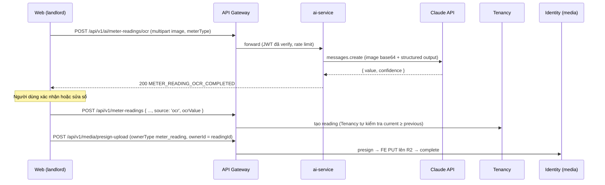

# P6-10 — AI service: OCR chỉ số công tơ (Epic)

**Trạng thái:** 🟡 Open  
**Người phụ trách:** baoduong17  
**Người review:** huynhtiennhat0403 (Billing), ThaiBao11125 (FE gọi API)  
**Ước lượng:** 6 points (P6-10a 3 + P6-10b 3)  
**Phụ thuộc:** —  
**Iteration:** 5 (scaffold) → 6 (OCR)  
**Issue:** `docs#107`

## Mục tiêu

Landlord chụp ảnh công tơ trên web → nhận số gợi ý → xác nhận → lưu reading bên Tenancy. AI service chỉ gợi ý, không lưu dữ liệu.

## Quyết định áp dụng

- `P6-D67` — `ai-service` riêng (NestJS, fork `boilerplate`, không DB), vision LLM, giới hạn 5 MB / 15 s, Tenancy không gọi AI. Thay `P3-D51`.
- `P6-D66` — Tenancy nhận `source`/`ocrValue`; ảnh minh chứng upload sau khi tạo reading.
- `P1-D35` — OCR sai/mờ thì người dùng sửa tay; luôn có đường nhập tay.

## Luồng

## Sub-issue

| ID | Task | Pts |
|---|---|---|
| [P6-10a](P6-10a-ai-service-scaffold-deploy.md) | Tạo repo `ai-service`, bỏ DB/RabbitMQ, deploy internal host, route gateway `/ai` | 3 |
| [P6-10b](P6-10b-ai-meter-reading-ocr-endpoint.md) | `POST /ai/meter-readings/ocr` gọi Claude vision, structured output | 3 |

Phía Tenancy: [P6-02h](P6-02h-meter-reading-ocr-preview.md). Phía FE: [P6-06b](P6-06b-fe-meter-reading-entry.md).

## Ngoài phạm vi

- AI Auto-Description, Matchmaking (`requirement.md`) — chờ PM, có thể thêm vào `ai-service` sau.
- Tenant tự chụp công tơ trên mobile.
